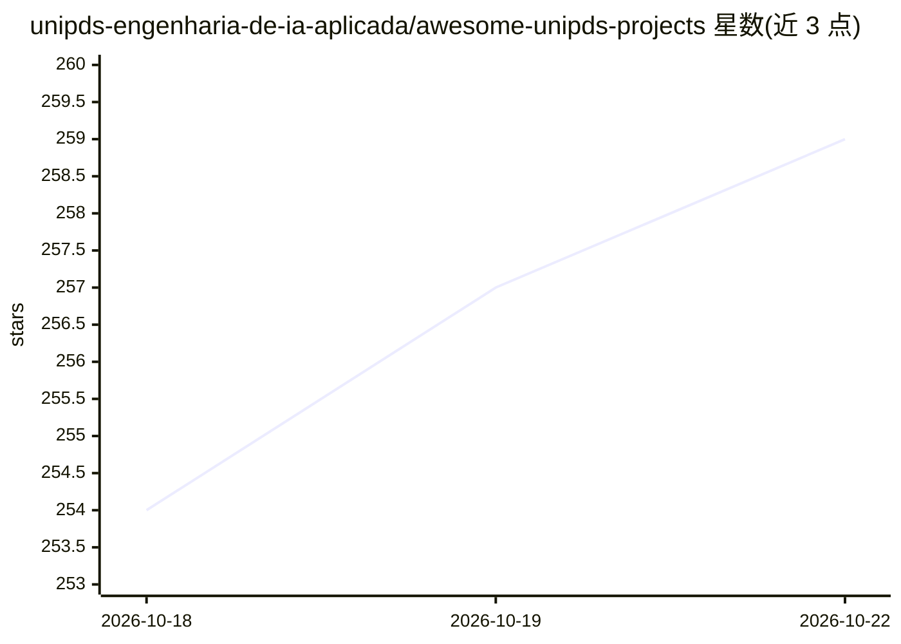

# unipds-engenharia-de-ia-aplicada/awesome-unipds-projects

⭐ 259 · 推送 2026-07-22 · [GitHub](https://github.com/unipds-engenharia-de-ia-aplicada/awesome-unipds-projects) · 组织维护

**UNIPDS 应用 AI 研究生课程学生原创项目策展清单**

UNIPDS 软件工程与应用 AI 研究生课程的学生原创项目展示清单，按 MCP 服务器、AI Agent、Web 应用与游戏、集成自动化、工具五类组织条目。每个条目标注编程语言/运行时、是否调用云 API、是否本地运行、是否集成多服务，并附作者。收录项目涉及 LangGraph、TensorFlow.js、MCP、RAG、Neo4j、浏览器端 Web AI 等技术，要求为全新创作而非课程练习复制。

## 筛选速览

| 维度 | 判定 | 备注 |
|---|---|---|
| AI 角色 | `ai-knowledge` | 知识聚合/清单类 |
| 许可风险 | `none` | — |
| 部署形态 | `None` |  |
| 模型依赖 | — | README 未给出锁定关系 |
| 硬件要求 | — | 无带数字的原话,不猜 |
| 安装摩擦 | `medium` | 含编译或系统依赖之一 |
| 成熟度 | — | 结构信号不足 |

## 能力要点

- 按 5 个类别组织的学生项目条目
- 每条目附语言/运行时、云/本地、集成度标签
- 覆盖 MCP 服务器、AI Agent、浏览器端 ML 等项目类型

## 适用场景

- 查找 UNIPDS 课程学生的原创 AI 项目
- 了解课程产出中 MCP、Agent、Web AI 等方向的实践案例

## 场景标签

 · 领域:教育/知识聚合

## 证据(README 行号)

> L1: /# Awesome UNIPDS Projects 🎓
> L3: A curated list of original projects built by students of the **UNIPDS Software engineering with Applied AI** postgra

## 星数曲线

2026-10-18 254 → 2026-10-22 259（+5）

---
*卡片 v1 · prompt 1.4 · 生成 2026-10-22 · 置信度 high · 依据 README sha `b8ebc17e7ec0` · [字段定义](../../DATASET.md)*
