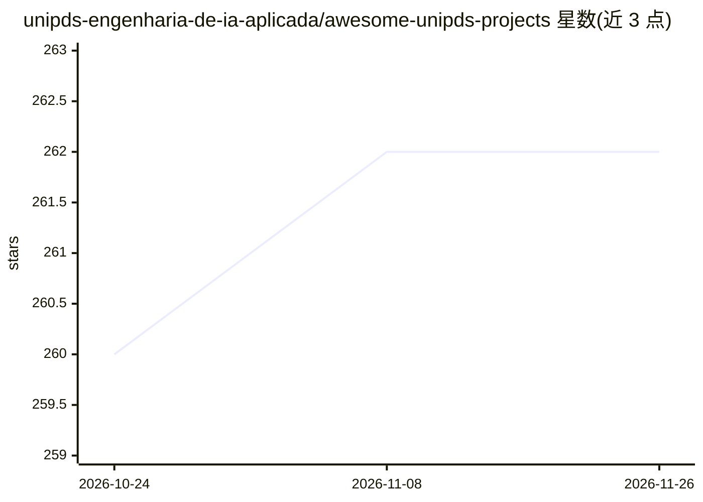

# unipds-engenharia-de-ia-aplicada/awesome-unipds-projects

⭐ 262 · 推送 2026-11-24 · [GitHub](https://github.com/unipds-engenharia-de-ia-aplicada/awesome-unipds-projects) · 组织维护

**UNIPDS 应用 AI 研究生课程学生原创项目的策展清单**

收录 UNIPDS「软件工程与应用 AI」研究生课程学生的原创项目，按 MCP 服务器、AI Agent、Web 应用与游戏、集成自动化、工具五类组织，每条附语言/运行时与部署范围标记（调用云 API、完全本地运行、多服务集成）。项目覆盖 LangGraph 多智能体、MCP 服务器、TensorFlow.js 浏览器端推理、RAG 管线等。清单要求条目为全新创作而非课堂练习复制品，通过 CONTRIBUTING.md 接受新增。

## 筛选速览

| 维度 | 判定 | 备注 |
|---|---|---|
| AI 角色 | `ai-knowledge` | 知识聚合/清单类 |
| 许可风险 | `none` | — |
| 部署形态 | `None` |  |
| 模型依赖 | — | README 未给出锁定关系 |
| 硬件要求 | — | 无带数字的原话,不猜 |
| 安装摩擦 | `medium` | 含编译或系统依赖之一 |
| 成熟度 | — | 结构信号不足 |

## 能力要点

- 按 MCP 服务器/AI Agent/Web 应用/集成/工具五类组织学生项目
- 每条目标注语言运行时与部署范围（云端 API/本地运行/多服务集成）
- 要求收录条目为原创作品，非课堂练习复制品

## 适用场景

- 浏览该课程学生 AI 项目的实现方向与技术选型
- 为 MCP 服务器或浏览器端 AI 应用寻找参考实现
- 按本地运行/云端调用等范围标签筛选项目

## 场景标签

`精选清单` · 领域:学习与行业

## 证据(README 行号)

> L3: A curated list of original projects built by students of the **UNIPDS Software engineering with Applied AI** postgra
> L27: ## Projects

## 星数曲线

2026-10-24 260 → 2026-11-26 262（+2）

---
*卡片 v1 · prompt 1.4 · 生成 2026-11-26 · 置信度 high · 依据 README sha `68168139723d` · [字段定义](../../DATASET.md)*
