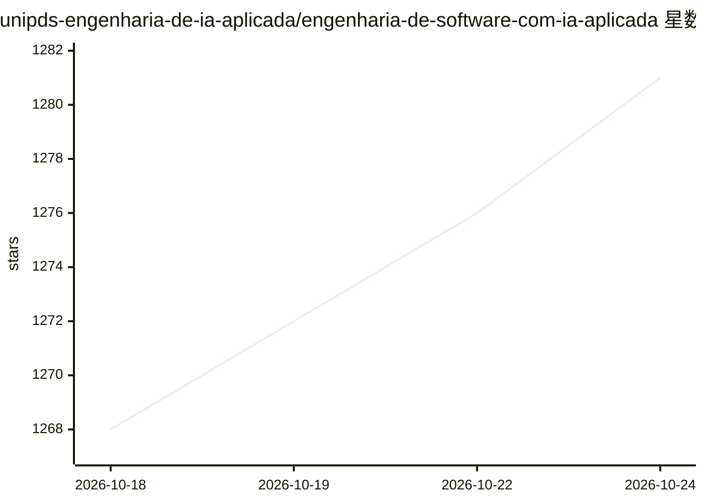

# unipds-engenharia-de-ia-aplicada/engenharia-de-software-com-ia-aplicada

⭐ 1,281 · TypeScript · NOASSERTION · 推送 2026-10-23 · [GitHub](https://github.com/unipds-engenharia-de-ia-aplicada/engenharia-de-software-com-ia-aplicada) · [官网](https://unipds.com.br/org-erick-wendel/?utm_source=github&utm_medium=bio&utm_campaign=bolsa_47&utm_term=&utm_content=perfil_erick) · 组织维护

**软件工程与应用 AI 研究生课程的参考资料与示例代码清单**

葡萄牙语研究生课程（Pós em Engenharia de Software com IA Aplicada）配套仓库：README 按模块（1-10 及模块 04）组织课程参考链接，覆盖 ML/DL 基础、Web AI、强化学习示例、Prompt Engineering、AI 编码工具、MCP 与自动化测试、开源与本地模型（Ollama/vLLM/OpenRouter 示例工程）、RAG 与嵌入（Neo4j/LangChain JS）。仓库内含多个示例项目目录（exemplo-01 至 exemplo-13 等），面向课程学员自学。

## 筛选速览

| 维度 | 判定 | 备注 |
|---|---|---|
| AI 角色 | `ai-knowledge` | 知识聚合/清单类 |
| 许可风险 | `none` | NOASSERTION |
| 部署形态 | `library` | 以包/库形式分发 |
| 模型依赖 | — | README 未给出锁定关系 |
| 硬件要求 | — | 无带数字的原话,不猜 |
| 安装摩擦 | `medium` | 含编译或系统依赖之一 |
| 成熟度 | — | 结构信号不足 |

## 能力要点

- 按 10+ 模块组织的课程参考链接清单
- 含 13+ 个示例项目目录（电商推荐、WebAI、Playwright 测试、Ollama、OpenRouter、Neo4j RAG 等）
- 覆盖 LangChain JS、MCP、RAG、本地模型运行等主题

## 适用场景

- 课程学员按模块查找补充学习资料
- 跟随示例工程实践 Web AI、RAG 与本地模型运行
- 了解课程各模块对应的实践项目

## 场景标签

`教程课程` `精选清单` · 领域:学习与行业

## 证据(README 行号)

> L3: Abaixo são as referências e links complementares às aulas, dividido por módulos e submodulos:
> L242: Projeto em exemplo-10-ollama/

## 星数曲线

2026-10-18 1,268 → 2026-10-24 1,281（+13）

---
*卡片 v1 · prompt 1.4 · 生成 2026-10-21 · 置信度 mid · 依据 README sha `1b9919bfe817` · [字段定义](../../DATASET.md)*
