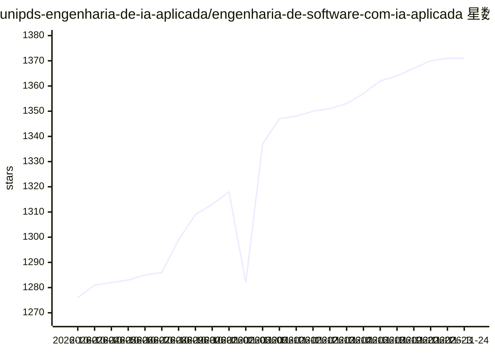

# unipds-engenharia-de-ia-aplicada/engenharia-de-software-com-ia-aplicada

⭐ 1,373 · TypeScript · NOASSERTION · 推送 2026-11-19 · [GitHub](https://github.com/unipds-engenharia-de-ia-aplicada/engenharia-de-software-com-ia-aplicada) · [官网](https://unipds.com.br/org-erick-wendel/?utm_source=github&utm_medium=bio&utm_campaign=bolsa_47&utm_term=&utm_content=perfil_erick) · 组织维护

**面向学员的 AI 应用软件工程课程参考链接合集**

这是面向巴西「AI 应用软件工程」研究生课程（Pós）的参考资料仓库，由授课团队维护。README 按课程模块与子模块组织链接：机器学习与深度学习基础、浏览器端 Web AI（TensorFlow.js、WebGPU、Chrome 内置 AI）、提示工程、MCP 与自动化、本地模型运行、RAG 与向量数据库、自主 Agent 开发等。每节多为外部教程与项目链接，部分模块配有示例项目目录（如推荐系统、游戏 AI、Neo4j RAG、Playwright 测试等）。

## 筛选速览

| 维度 | 判定 | 备注 |
|---|---|---|
| AI 角色 | `ai-knowledge` | 知识聚合/清单类 |
| 许可风险 | `none` | NOASSERTION |
| 部署形态 | `library` | 以包/库形式分发 |
| 模型依赖 | — | README 未给出锁定关系 |
| 硬件要求 | — | 无带数字的原话,不猜 |
| 安装摩擦 | `medium` | 含编译或系统依赖之一 |
| 成熟度 | — | 结构信号不足 |

## 能力要点

- 按课程模块组织的分类参考链接集
- 覆盖 Web AI、MCP、本地模型运行、RAG、Agent 等主题
- 多个模块配有示例项目目录（exemplo-01 至 exemplo-13 等）
- 包含 JavaScript/TypeScript 生态（LangChain JS、TF.js）示例

## 适用场景

- 学习在浏览器中运行机器学习与 LLM 推理
- 查找 LangChain JS 与 Neo4j 构建 RAG 的资料
- 了解 MCP 及 AI 辅助测试、导航等开发工作流

## 场景标签

`教程课程` `精选清单` · 领域:学习与行业

## 证据(README 行号)

> L3: Abaixo são as referências e links complementares às aulas, dividido por módulos e submodulos:
> L5: ## Modulo 01 - Fundamentos de IA e LLMs para Programadores

## 星数曲线

2026-10-22 1,276 → 2026-11-24 1,371（+95）

---
*卡片 v1 · prompt 1.4 · 生成 2026-11-23 · 置信度 mid · 依据 README sha `c0df8da99a53` · [字段定义](../../DATASET.md)*
