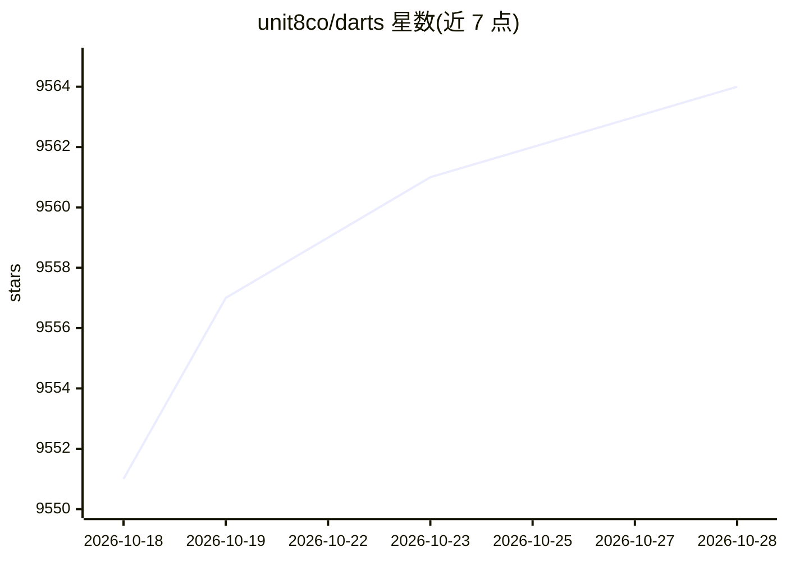

# unit8co/darts

⭐ 9,566 · Python · Apache-2.0 · 推送 2026-10-28 · [GitHub](https://github.com/unit8co/darts) · [官网](https://unit8co.github.io/darts/) · 组织维护

**Python 时间序列预测与异常检测库，供开发者和数据科学家使用**

面向时序任务的 Python 库，提供从 ARIMA、指数平滑等统计模型到 N-BEATS、TFT、TiDE 等深度学习模型的大量预测模型，全部通过统一的 fit()/predict() 接口使用（类似 scikit-learn）。支持多变量与多序列全局训练、概率预测、共形预测、协变量输入、层级调和、回测与 SHAP 可解释性；darts.ad 模块提供异常评分器/检测器，可套用 PyOD 检测器。深度模型基于 PyTorch Lightning 实现，支持 GPU/TPU 训练，并集成 MLflow 实验跟踪。经 pip 安装，需 Python 3.11+。

## 筛选速览

| 维度 | 判定 | 备注 |
|---|---|---|
| AI 角色 | `ai-native` | 本体是模型或模型工具 |
| 许可风险 | `permissive` | Apache-2.0 |
| 部署形态 | `library` | 以包/库形式分发 |
| 模型依赖 | — | README 未给出锁定关系 |
| 硬件要求 | — | 无带数字的原话,不猜 |
| 安装摩擦 | `low` | 无编译、无系统依赖或容器化 |
| 成熟度 | — | 结构信号不足 |

## 能力要点

- 统一 fit()/predict() 接口覆盖 ARIMA 到深度学习的多种预测模型
- 多变量、多序列全局训练与概率/共形预测支持
- darts.ad 异常检测模块，可包装任意预测模型并套用 PyOD
- TimeSeries 兼容 pandas/polars/numpy/xarray 等多后端

## 适用场景

- 对业务指标做单变量或多变量时间序列预测
- 在时序数据上计算异常分数并输出二分类异常结果
- 用历史滑动窗口回测多个模型并比较效果

## 场景标签

 · 领域:机器学习/时间序列

## 证据(README 行号)

> L16: **Darts** is a Python library for user-friendly forecasting and anomaly detection
> L17: on time series. It contains a variety of models, from classics such as ARIMA to
> L18: deep neural networks. The forecasting models can all be used in the same way,

## 星数曲线

2026-10-18 9,551 → 2026-10-28 9,564（+13）

---
*卡片 v1 · prompt 1.4 · 生成 2026-10-20 · 置信度 high · 依据 README sha `df55a6ee53d3` · [字段定义](../../DATASET.md)*
