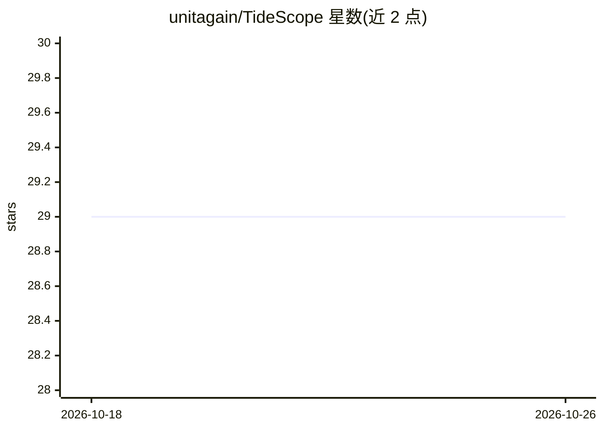

# unitagain/TideScope

⭐ 29 · Python · 推送 2025-11-27 · [GitHub](https://github.com/unitagain/TideScope) · [官网](https://github.com/unitagain/TideScope#readme) · 组织维护 · 中文 README

**扫描 GitHub 仓库生成贡献者指南与技术债务星图的开源协作工具**

面向开源新手贡献者与项目维护者的交互式 CLI 工具：通过 GitHub API 抓取 Issues、PRs 与代码 TODO 注释，可选接入 LLM（Deepseek/OpenAI）提取任务所需技能、评估难度与优先级并生成实现建议；无 API key 时自动回退到规则分析。输出两套系统：技术债务星图（黄金角螺旋极坐标布局、PR-Issue 星座聚类、ECharts 可视化）与徽章系统（项目健康面板、SVG 任务徽章、AI 生成 CONTRIBUTING.md）。提供 Web UI 与 CLI 双界面。

## 筛选速览

| 维度 | 判定 | 备注 |
|---|---|---|
| AI 角色 | `ai-enhanced` | 去掉 AI 部分产品仍成立 |
| 许可风险 | `none` | — |
| 部署形态 | `library` | 以包/库形式分发 |
| 模型依赖 | — | README 未给出锁定关系 |
| 硬件要求 | — | 无带数字的原话,不猜 |
| 安装摩擦 | `low` | 无编译、无系统依赖或容器化 |
| 成熟度 | — | 结构信号不足 |

## 能力要点

- 扫描本地代码或远程 GitHub 仓库的 Issues/PRs/TODO 注释
- LLM 技能提取与难度（1-5）、优先级多维评分，无 API key 时回退规则分析
- 黄金角螺旋 + 力导向防重叠的星图布局，PR-Issue 星座聚类
- AI 生成 CONTRIBUTING.md 与 SVG 任务徽章、项目健康评分

## 适用场景

- 开源新手按技能和难度筛选适合自己的入门任务
- 维护者全局查看项目技术债务分布并排定优先级
- 一键生成含健康指标与推荐任务的贡献者指南

## 场景标签

`代码审查` · 领域:编码与开发

## 证据(README 行号)

> L21: **TideScope** is inspired by star maps. By **scanning GitHub repositories for Issues, PRs, and TODO comments in cod
> L245: - Automatically uses rule-based analysis when no API key

## 星数曲线

2026-10-18 29 → 2026-10-26 29（+0）

---
*卡片 v1 · prompt 1.4 · 生成 2026-10-26 · 置信度 mid · 依据 README sha `7eb5a8b95fd6` · [字段定义](../../DATASET.md)*
