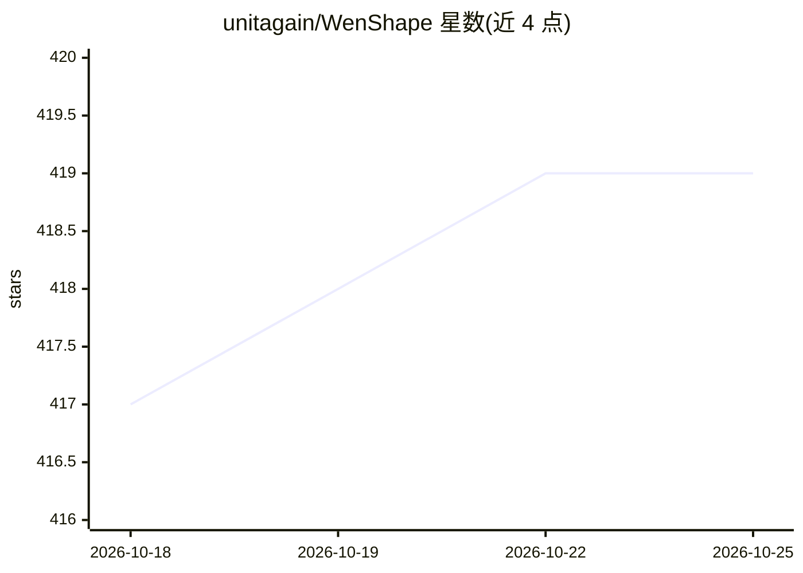

# unitagain/WenShape

⭐ 419 · Python · NOASSERTION · 推送 2026-10-03 · [GitHub](https://github.com/unitagain/WenShape) · [官网](https://wenshape.cn) · 个人维护 · 中文 README

**面向中长篇小说创作的智能体写作系统**

面向中长篇小说作者的智能体创作系统：将写作拆为分卷章节结构、人物/世界观/文风卡片、章节摘要、事实库与编辑审阅等可维护模块。后端以 orchestrator + agents + context_engine + storage 组织流程，上下文检索结合 BM25、实体增强、章节绑定与事实距离衰减做选择性注入。支持同人创作工作流（百科/网页搜索抓取生成卡片提案），模型层经 llm_gateway 内置支持 OpenAI、Anthropic、DeepSeek、Gemini、通义千问、文心一言等。项目数据落在 YAML/Markdown/JSONL 纯文本格式。提供 Windows 一键发布包与源码部署两种方式；许可证为 PolyForm Noncommercial（非商业）。

## 筛选速览

| 维度 | 判定 | 备注 |
|---|---|---|
| AI 角色 | `ai-native` | 本体是模型或模型工具 |
| 许可风险 | `none` | NOASSERTION |
| 部署形态 | `desktop` | 安装包/桌面程序 |
| 模型依赖 | locked-api |  |
| 硬件要求 | — | 无带数字的原话,不猜 |
| 安装摩擦 | `low` | 无编译、无系统依赖或容器化 |
| 成熟度 | — | 结构信号不足 |

## 能力要点

- 分卷章节结构与人物/世界观/文风三类卡片的结构化存储
- 按章节距离衰减的事实检索与选择性上下文注入
- 同人工作流：搜索/预览/抓取/提案四步生成卡片提案
- llm_gateway 统一接入 OpenAI/Anthropic/DeepSeek/Gemini/Qwen/文心一言及 OpenAI 兼容接口

## 适用场景

- 长篇连载写作中保持人物与世界观的一致性
- 基于百科与网页资料整理原作设定进行同人创作
- 按卷规划、按章推进并回溯章节摘要的长篇创作

## 场景标签

`AI 写作` · 领域:内容生成

## 证据(README 行号)

> L18: 文枢是一个面向中长篇小说创作的智能体系统。它不把模型当成一次性写完整本书的黑盒，而是把写作拆成多个可见、可维护、可回溯的模块: 分卷与章节结构、人物与世界观卡片、章节摘要、事实库、编辑审阅、同人导入、模型配置。
> L78: 文枢的模型层不是把供应商逻辑散落在页面和业务代码里，而是通过 `llm_gateway` 统一抽象。当前配置页内置支持 OpenAI、Anthropic、DeepSeek、Gemini、Qwen 通义千问、Wenxin 文心一言、

## 星数曲线

2026-10-18 417 → 2026-10-25 419（+2）

---
*卡片 v1 · prompt 1.4 · 生成 2026-10-21 · 置信度 high · 依据 README sha `a7f0086b0f3b` · [字段定义](../../DATASET.md)*
