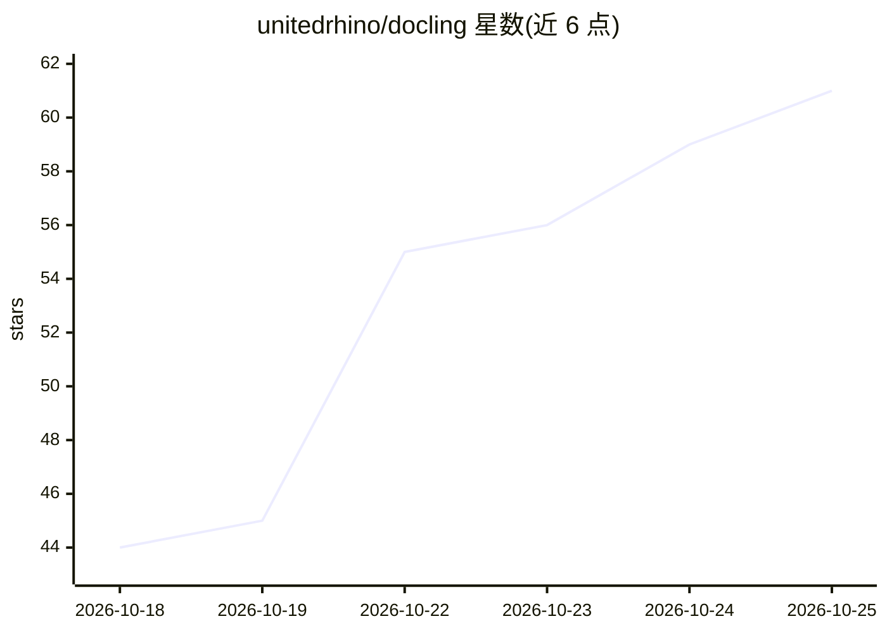

# unitedrhino/docling

⭐ 61 · Go · MIT · 推送 2026-10-14 · [GitHub](https://github.com/unitedrhino/docling) · [官网](https://www.unitedrhino.com/) · 组织维护 · 中文 README

**纯 Go 文档解析库：12+ 种格式统一转为 Docling 协议供 LLM 摄入**

Docling 协议的纯 Go 实现，将 PDF、Word、PPT、Excel、HTML、Markdown、EML、图片、CAD 图纸、GLB 等格式解析为统一的 DoclingDocument 结构化模型（对齐 Docling Core 1.10.0 协议），输出 Markdown/JSON/content_list 等，供 RAG 切片与 Agent 工具链使用。规则引擎处理结构化内容，扫描件、图片表格、公式页按质量信号路由给可选的大模型钩子（OCRHook/PDFVisualHook），支持任意 OpenAI 兼容多模态模型。单二进制零外部服务，提供 Go 库与 CLI 两种使用方式。

## 筛选速览

| 维度 | 判定 | 备注 |
|---|---|---|
| AI 角色 | `ai-ecosystem` | LLM/agent 周边工具 |
| 许可风险 | `permissive` | MIT |
| 部署形态 | `library` | 以包/库形式分发 |
| 模型依赖 | — | README 未给出锁定关系 |
| 硬件要求 | — | 无带数字的原话,不猜 |
| 安装摩擦 | `low` | 无编译、无系统依赖或容器化 |
| 成熟度 | — | 结构信号不足 |

## 能力要点

- 12+ 种输入格式统一解析为 Docling Core 1.10.0 协议输出
- 规则引擎保底，疑难页按质量信号自动路由给大模型钩子（OCRHook/PDFVisualHook）
- 纯 Go 单二进制，零 Python、零外部服务，go get 即用
- 提供 Hierarchical/Hybrid 分块器与知识库分块策略

## 适用场景

- RAG 知识库入库前的多格式文档解析与切片
- 批量文档摄入与 CI 环境中的轻量级解析
- 扫描件或图片表格页挂接多模态大模型增强识别

## 场景标签

`文档解析` · 领域:知识与检索

## 证据(README 行号)

> L7: `docling` 将 PDF、DOC/DOCX、PPTX、BIFF8 XLS/XLSX、EPUB、CHM、CSV、HTML、Markdown、AsciiDoc、EML 邮件、图片、纯文本、CAD 图纸(DWG/DXF)与 GLB 
> L59: - 🧠 **现代混合架构**:规则引擎覆盖结构化内容,扫描件、图片表格、公式密集页自动按页路由给大模型(`OCRHook`/`PDFVisualHook`)——把模型用在刀刃上,而不是每个页面

## 星数曲线

2026-10-18 44 → 2026-10-25 61（+17）

---
*卡片 v1 · prompt 1.4 · 生成 2026-10-24 · 置信度 high · 依据 README sha `635b39b01513` · [字段定义](../../DATASET.md)*
