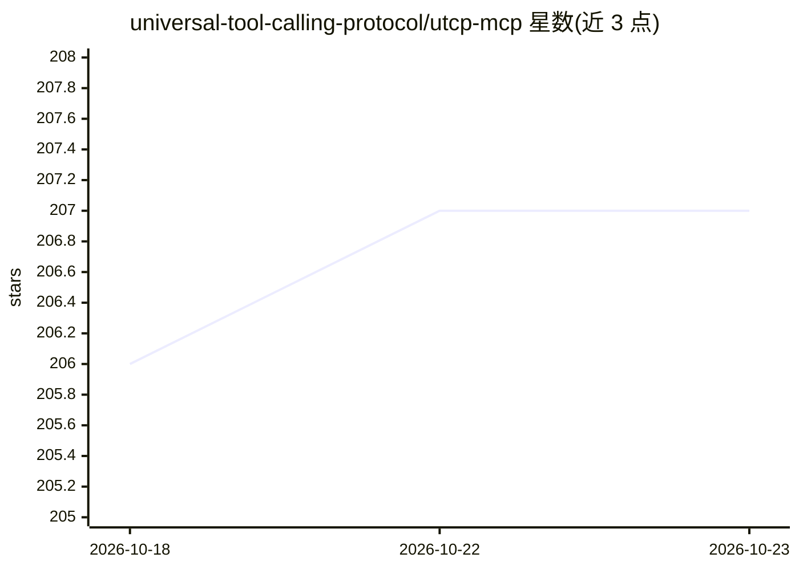

# universal-tool-calling-protocol/utcp-mcp

⭐ 207 · Python · 推送 2026-05-03 · [GitHub](https://github.com/universal-tool-calling-protocol/utcp-mcp) · 组织维护

**将 UTCP 工具生态桥接为 MCP 服务的通用网关**

基于 Universal Tool Calling Protocol 的 MCP 服务器：把 UTCP 配置中注册的手册/工具统一暴露为 MCP 工具，供 Claude Desktop、Claude Code 等 MCP 客户端调用。暴露的 MCP 工具包括注册/注销手册、调用工具、搜索、列举、查询 schema 与所需环境变量等；支持通过 npx 免安装运行，工具配置动态更新无需重启。另含 Python 版实现与 Web 管理界面。给需要让 AI agent 接入任意 API、命令行工具与文件处理工具的开发者使用。

## 筛选速览

| 维度 | 判定 | 备注 |
|---|---|---|
| AI 角色 | `ai-ecosystem` | LLM/agent 周边工具 |
| 许可风险 | `none` | — |
| 部署形态 | `library` | 以包/库形式分发 |
| 模型依赖 | — | README 未给出锁定关系 |
| 硬件要求 | — | 无带数字的原话,不猜 |
| 安装摩擦 | `low` | 无编译、无系统依赖或容器化 |
| 成熟度 | — | 结构信号不足 |

## 能力要点

- 经 npx 运行，无需安装即可注册 UTCP 手册为 MCP 工具
- 提供 register/call/search/list 等 8 个工具管理类 MCP 工具
- 配置动态更新，无需重启即可变更工具集
- 含独立 Python 版实现与 Web 管理界面

## 适用场景

- 让 Claude 等 MCP 客户端调用 HTTP/OpenAPI 接口与命令行工具
- 统一管理多个项目的工具配置（环境隔离）
- 通过 Web 界面管理已注册的工具生态

## 场景标签

 · 领域:AI Agent 基础设施/工具协议

## 证据(README 行号)

> L5: A universal, all-in-one MCP server that brings the full power of the Universal Tool Calling Protocol (UTCP) to the M
> L70: - **`call_tool`** - Execute any registered UTCP tool
> L78: The Universal Tool Calling Protocol (UTCP) allows you to:

## 星数曲线

2026-10-18 206 → 2026-10-23 207（+1）

---
*卡片 v1 · prompt 1.4 · 生成 2026-10-22 · 置信度 high · 依据 README sha `4874ad7293cd` · [字段定义](../../DATASET.md)*
