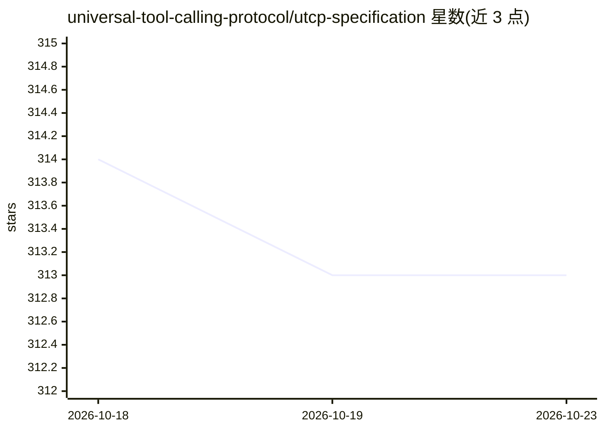

# universal-tool-calling-protocol/utcp-specification

⭐ 313 · TypeScript · NOASSERTION · 推送 2026-09-16 · [GitHub](https://github.com/universal-tool-calling-protocol/utcp-specification) · [官网](https://www.utcp.io/) · 组织维护

**通用工具调用协议（UTCP）的官方规范文档仓库**

定义 AI 系统等客户端跨协议发现和调用工具的标准：覆盖工具发现机制、调用格式与模板、插件化架构、认证与错误处理。v1.0 采用插件架构，通过插件支持 HTTP、CLI、WebSocket、Text 及 MCP 协议，提供 Pydantic 数据模型与异步客户端接口，配套 v0.1 到 v1.0 迁移指南。文档基于 Docusaurus 构建，需 Node.js 18+ 环境本地运行；规范按语义化版本管理，仓库按目录采用双许可。

## 筛选速览

| 维度 | 判定 | 备注 |
|---|---|---|
| AI 角色 | `ai-ecosystem` | LLM/agent 周边工具 |
| 许可风险 | `none` | NOASSERTION |
| 部署形态 | `library` | 以包/库形式分发 |
| 模型依赖 | — | README 未给出锁定关系 |
| 硬件要求 | — | 无带数字的原话,不猜 |
| 安装摩擦 | `low` | 无编译、无系统依赖或容器化 |
| 成熟度 | — | 结构信号不足 |

## 能力要点

- 定义工具发现、调用格式、插件架构、认证与错误处理的标准
- v1.0 通过插件支持 HTTP/CLI/WebSocket/Text/MCP 多协议
- 提供 v0.1 到 v1.0 的迁移指南与分角色实现文档（工具提供方/调用方）
- 规范遵循语义化版本管理，含向后兼容的版本化文档

## 适用场景

- 为 AI agent 实现跨协议统一的工具调用接口
- 查阅 UTCP 协议规范与各协议实现指南
- 工具提供方与调用方按规范实现互操作

## 场景标签

 · 领域:AI agent 基础设施/协议规范

## 证据(README 行号)

> L7: UTCP provides a standardized way for AI systems and other clients to discover and call tools from different provider
> L22: - **Multiple Protocol Support**: HTTP, CLI, WebSocket, Text, and MCP protocols via plugins

## 星数曲线

2026-10-18 314 → 2026-10-23 313（-1）

---
*卡片 v1 · prompt 1.4 · 生成 2026-10-21 · 置信度 high · 依据 README sha `ce18cd428452` · [字段定义](../../DATASET.md)*
