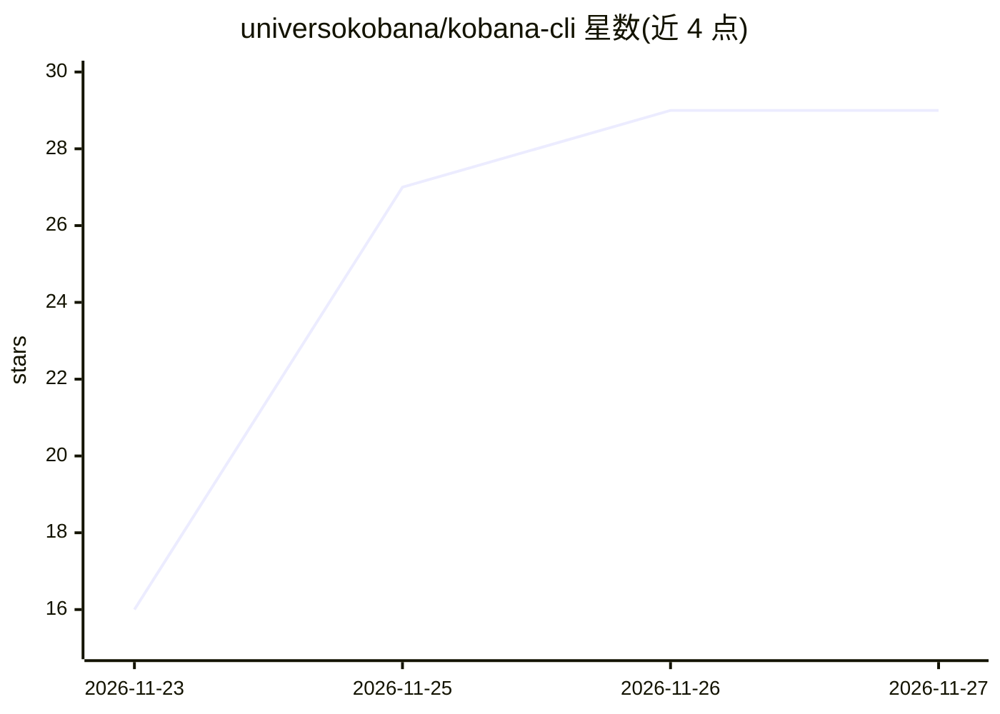

# universokobana/kobana-cli

⭐ 29 · Rust · MIT · 推送 2026-11-22 · [GitHub](https://github.com/universokobana/kobana-cli) · [官网](https://www.kobana.com.br/ia/cli) · 组织维护

**面向人类与 AI agent 的巴西多银行金融操作命令行工具**

Kobana 七个产品 API 的统一命令行客户端，单个二进制覆盖银行网关（40+ 银行的 boleto/Pix/TED 与对账）、财务后台、自动开票、邮件 agent 收件箱、催收、仪表盘和 Kadu AI agent。为终端与 agent 场景设计：结构化 JSON 输出、schema 自省、dry-run、自动分页；各产品独立凭证，支持 OAuth+PKCE 浏览器登录、环境变量 token 与 client credentials，token 自动刷新并加密存储。

## 筛选速览

| 维度 | 判定 | 备注 |
|---|---|---|
| AI 角色 | `ai-enhanced` | 去掉 AI 部分产品仍成立 |
| 许可风险 | `permissive` | MIT |
| 部署形态 | `desktop` | 安装包/桌面程序 |
| 模型依赖 | — | README 未给出锁定关系 |
| 硬件要求 | — | 无带数字的原话,不猜 |
| 安装摩擦 | `low` | 无编译、无系统依赖或容器化 |
| 成熟度 | — | 结构信号不足 |

## 能力要点

- 单一二进制接入七个产品 API，含 40+ 银行的支付/收款/转账/对账操作
- 面向 agent 的设计：JSON 输出、schema 自省、dry-run、自动分页、aggregates 端点减少上下文占用
- OAuth+PKCE 浏览器登录与 token 环境变量两种认证路径，凭证按产品加密存储
- 多渠道安装：脚本、apt/dnf/zypper、Homebrew、WinGet、Nix、预编译二进制、源码编译

## 适用场景

- 在终端直接查询余额、发 boleto、走 Pix 和 TED 转账
- 让本机或 CI 中的 AI agent 以 JSON 方式调用银行与财务 API
- 管理订阅计费、催收流程与欠款恢复
- 通过 Kadu agent 运行组织定义的财务自动化任务

## 场景标签

 · 领域:金融/开发者工具

## 证据(README 行号)

> L6: Projetado para humanos e agentes de IA, com saída JSON estruturada, introspecção
> L39: Operações bancárias unificadas: uma única API conectada a mais de 40 bancos para
> L148: Agente de IA que executa rotinas financeiras (as Tasks) a partir do

## 星数曲线

2026-11-23 16 → 2026-11-27 29（+13）

---
*卡片 v1 · prompt 1.4 · 生成 2026-11-23 · 置信度 high · 依据 README sha `b5a27271c2b8` · [字段定义](../../DATASET.md)*
