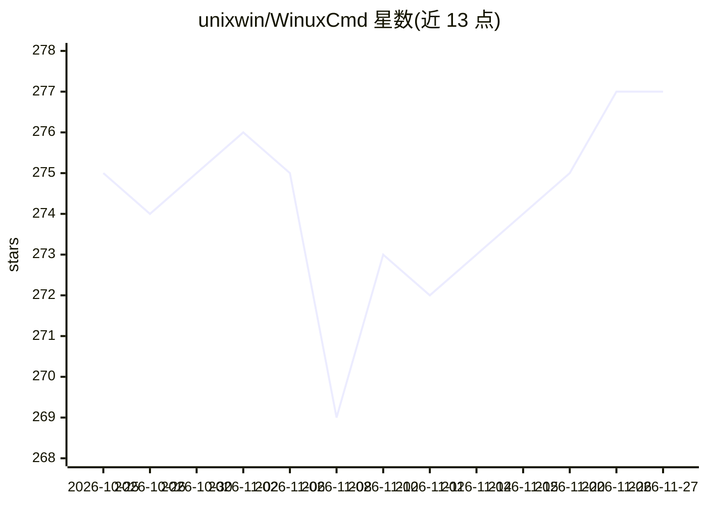

# unixwin/WinuxCmd

⭐ 277 · C++ · MIT · 推送 2026-11-26 · [GitHub](https://github.com/unixwin/WinuxCmd) · [官网](https://unixwin.dev/products/winuxcmd/) · 组织维护 · 中文 README

**为 Windows 用户提供 176 个原生 Unix 命令，单执行文件无需 WSL**

一个 Win32 原生可执行文件，在 Windows 本地路径上提供 GNU 语法的 176 个命令，覆盖 coreutils、findutils、grep/sed、util-linux 等家族；无需 WSL、Cygwin 或 MSYS2。2.0 版将命令核心迁移到 Rust 静态库，与 C++ 前端链接为单一镜像；每条已接入命令通过 GNU oracle 字节级比对、ctest 基线与新旧 exe 参数矩阵三重差分门禁。提供 Default/Full 两种版本与 wpm 包管理器，README 声明体积约 3.0MB，标注 AI-friendly。

## 筛选速览

| 维度 | 判定 | 备注 |
|---|---|---|
| AI 角色 | `ai-enhanced` | 去掉 AI 部分产品仍成立 |
| 许可风险 | `permissive` | MIT |
| 部署形态 | `desktop` | 安装包/桌面程序 |
| 模型依赖 | — | README 未给出锁定关系 |
| 硬件要求 | — | 无带数字的原话,不猜 |
| 安装摩擦 | `medium` | 含编译或系统依赖之一 |
| 成熟度 | — | 结构信号不足 |

## 能力要点

- 176 个命令以单一原生 Win32 执行文件提供，无运行时与虚拟机依赖
- 2.0 将 50 个 applet 迁移至 Rust 核心，行为以 GNU oracle 逐字节验证
- 流式 stdin 回调与注入式 IO，无进程级全局状态
- 提供 winget、安装包、便携 zip 与源码构建四种获取方式

## 适用场景

- 在 Windows 上直接使用 grep/sed/find 等 GNU 语法命令
- 避免 WSL 的虚拟机文件系统边界与安装开销
- 在脚本中用 GNU 行为一致的工具处理 Windows 路径

## 场景标签

 · 领域:开发者工具/命令行

## 证据(README 行号)

> L4: No WSL · No Cygwin · No MSYS2 · No path-translation pain
> L27: GNU syntax on Windows paths: **176 commands**, no runtime, no VM. 2.0 moves

## 星数曲线

2026-10-25 275 → 2026-11-27 277（+2）

---
*卡片 v1 · prompt 1.4 · 生成 2026-11-25 · 置信度 mid · 依据 README sha `4a313389d048` · [字段定义](../../DATASET.md)*
