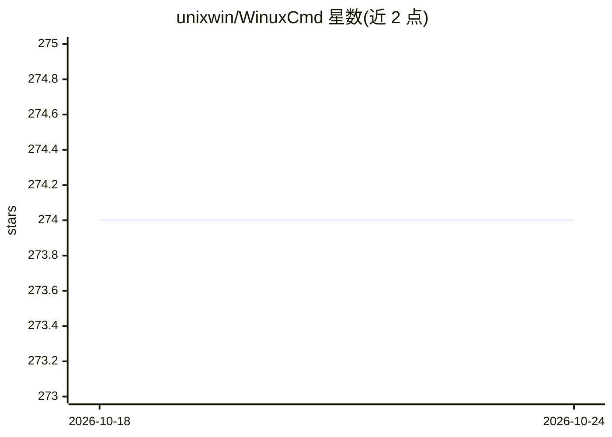

# unixwin/WinuxCmd

⭐ 275 · C++ · MIT · 推送 2026-10-24 · [GitHub](https://github.com/unixwin/WinuxCmd) · [官网](https://dl.caomengxuan666.com/) · 个人维护 · 中文 README

**Windows 原生 Unix 命令行工具集：单个 3MB 二进制提供 176 个 GNU 命令**

以 C++23 编写的原生 Win32 可执行文件，在 Windows 上实现 176 个 Unix 命令与 1,924 个选项，覆盖 coreutils、findutils、grep、sed、BSD 工具与进程管理，grep 内置 PCRE2，find 实现 88 个选项。针对 GNU coreutils 9.7 做差分测试（178 例、93% 通过），附带 2,420 个单元测试。内置 WPM 包管理器安装 jq、ripgrep 等外部工具，配套同组织的 niubash 提供 bash 语法；`niu -c` 输出确定、退出码精确，面向 AI agent 调用设计。提供安装包、便携版与源码构建三种方式。

## 筛选速览

| 维度 | 判定 | 备注 |
|---|---|---|
| AI 角色 | `ai-enhanced` | 去掉 AI 部分产品仍成立 |
| 许可风险 | `permissive` | MIT |
| 部署形态 | `desktop` | 安装包/桌面程序 |
| 模型依赖 | — | README 未给出锁定关系 |
| 硬件要求 | — | 无带数字的原话,不猜 |
| 安装摩擦 | `medium` | 含编译或系统依赖之一 |
| 成熟度 | — | 结构信号不足 |

## 能力要点

- 单文件原生 Win32 二进制，176 命令 / 1,924 选项，零运行时依赖
- 针对 GNU coreutils 9.7 的 178 例差分测试，93% 通过
- 内置 WPM 包管理器安装 jq、ripgrep、fzf 等外部工具
- 配套 niubash 提供 bash 语言与面向 agent 的确定性 `niu -c` 模式

## 适用场景

- 在 Windows 上直接使用 grep/sed/find 等 GNU 命令而无需 WSL/Cygwin
- 为 AI agent 提供输出确定、退出码稳定的命令行环境
- 用便携版随项目分发一套 Unix 工具链

## 场景标签

 · 领域:系统工具/命令行

## 证据(README 行号)

> L72: - **Agent-friendly** — `niu -c` is quiet and deterministic: no banners, stable stdout/stderr, exact exit codes. The
> L3: **Real Unix commands. Real Windows paths. One ~3 MB executable.**

## 星数曲线

2026-10-18 274 → 2026-10-24 274（+0）

---
*卡片 v1 · prompt 1.4 · 生成 2026-10-22 · 置信度 mid · 依据 README sha `ec2f98c55e35` · [字段定义](../../DATASET.md)*
