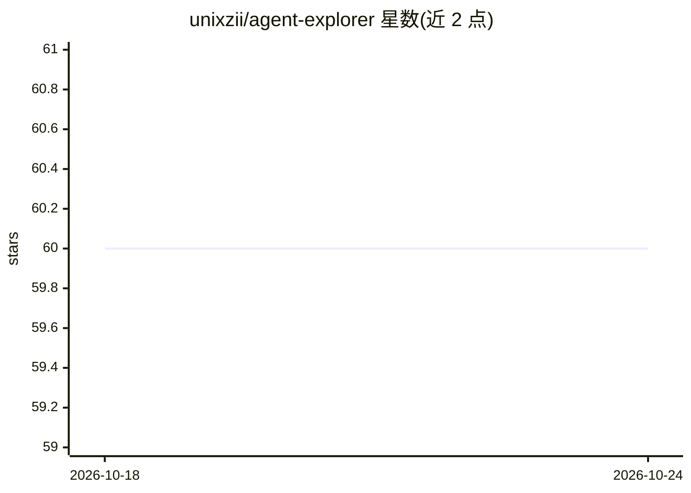

# unixzii/agent-explorer

⭐ 60 · TypeScript · MIT · 推送 2026-09-05 · [GitHub](https://github.com/unixzii/agent-explorer) · [官网](https://agent-explorer.cy4n.dev/) · 个人维护

**浏览器端查看 agent 会话 JSONL 日志的探查器**

基于浏览器的 agent 会话日志探查工具：打开 JSONL 文件后，在三个联动视图（时间线、对话视图、事件详情面板）中浏览完整会话。自动检测文件格式，支持 Claude Code transcript、Codex rollout、Pi session 三种格式。解析完全在浏览器本地进行，不上传任何数据。提供 token 用量与估算成本、事件搜索过滤、明暗主题等功能。需 Node.js 23+ 与 pnpm 10+ 从源码构建运行，MIT 许可。

## 筛选速览

| 维度 | 判定 | 备注 |
|---|---|---|
| AI 角色 | `ai-ecosystem` | LLM/agent 周边工具 |
| 许可风险 | `permissive` | MIT |
| 部署形态 | `library` | 以包/库形式分发 |
| 模型依赖 | — | README 未给出锁定关系 |
| 硬件要求 | — | 无带数字的原话,不猜 |
| 安装摩擦 | `low` | 无编译、无系统依赖或容器化 |
| 成熟度 | — | 结构信号不足 |

## 能力要点

- 时间线/对话/详情三个联动视图浏览会话
- 自动检测 JSONL 格式（Claude Code/Codex/Pi 三种）
- 解析全程在浏览器本地，不上传数据
- 展示会话元数据、token 用量与估算成本

## 适用场景

- 回放和检查 Claude Code 或 Codex 的会话记录
- 排查 agent 会话中的工具调用与事件细节
- 查看会话 token 消耗与成本估算

## 场景标签

`LLM 可观测性` · 领域:评测与运维

## 证据(README 行号)

> L3: A browser-based explorer for agent session logs. Open a JSONL file and browse the full session across three linked v
> L52: |Claude Code transcript|Per-line `user` / `assistant` events with `message.content` blocks|

## 星数曲线

2026-10-18 60 → 2026-10-24 60（+0）

---
*卡片 v1 · prompt 1.4 · 生成 2026-10-24 · 置信度 mid · 依据 README sha `1e5479be9a2d` · [字段定义](../../DATASET.md)*
