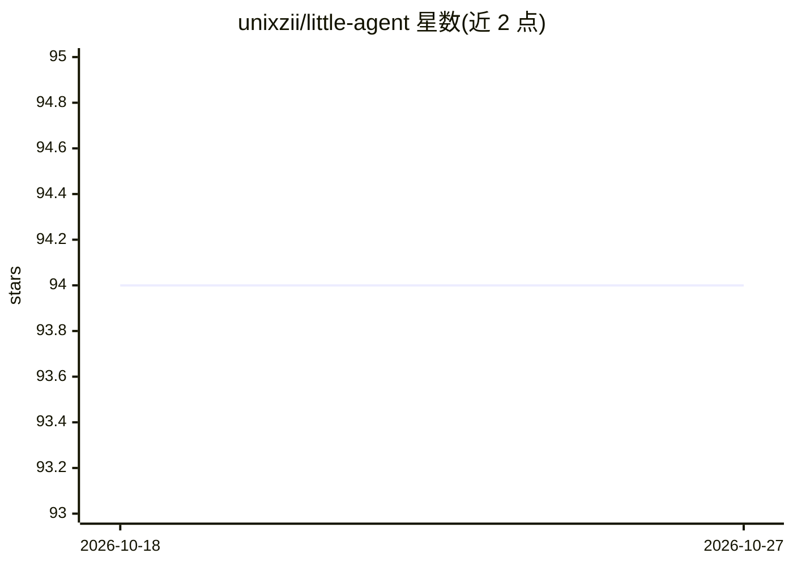

# unixzii/little-agent

⭐ 94 · Rust · MIT · 推送 2026-02-13 · [GitHub](https://github.com/unixzii/little-agent) · 个人维护

**轻量可嵌入式 agent 框架（Rust，含 C API 与 CLI）**

用 Rust 编写的嵌入式 agent 框架，定位类似 Claude Code 与 OpenAI Codex。核心机制为简单循环：模型接收输入并可输出工具调用请求，agent 执行工具并将结果回传模型，循环直至无更多工具调用。提供三种使用形态：little-agent crate（内置工具、开箱即用）、core crate（细粒度控制）以及导出的 C API（可编译为动态库链接到其他应用，为其添加 agentic 功能）；另有主要作演示用途的基础 CLI，需设置 OPENAI_API_KEY/OPENAI_BASE_URL/OPENAI_MODEL 环境变量后 cargo run 运行。MIT 许可。

## 筛选速览

| 维度 | 判定 | 备注 |
|---|---|---|
| AI 角色 | `ai-ecosystem` | LLM/agent 周边工具 |
| 许可风险 | `permissive` | MIT |
| 部署形态 | `None` |  |
| 模型依赖 | — | README 未给出锁定关系 |
| 硬件要求 | — | 无带数字的原话,不猜 |
| 安装摩擦 | `low` | 无编译、无系统依赖或容器化 |
| 成熟度 | — | 结构信号不足 |

## 能力要点

- 核心为 KISS 设计的模型-工具调用循环
- 导出 C API，可编译为动态库嵌入其他应用
- 提供含内置工具的 crate 与细粒度 core crate 两级 Rust API
- 附带演示用 CLI，支持配置自定义 OpenAI 兼容端点

## 适用场景

- 在我的 Rust/C/C++ 应用中嵌入 agentic 能力
- 学习或研究 agent 循环的最小实现
- 通过 OpenAI 兼容端点搭建自己的对话 agent CLI

## 场景标签

`Agent 框架` · 领域:Agent 开发

## 证据(README 行号)

> L3: `little-agent` is a lightweight embedded agent framework (similar to Claude Code and OpenAI Codex). It supports mult
> L9: There are already many agent projects around the world, and they are valuable both for practical use and for study. 

## 星数曲线

2026-10-18 94 → 2026-10-27 94（+0）

---
*卡片 v1 · prompt 1.4 · 生成 2026-10-23 · 置信度 high · 依据 README sha `611f94560955` · [字段定义](../../DATASET.md)*
