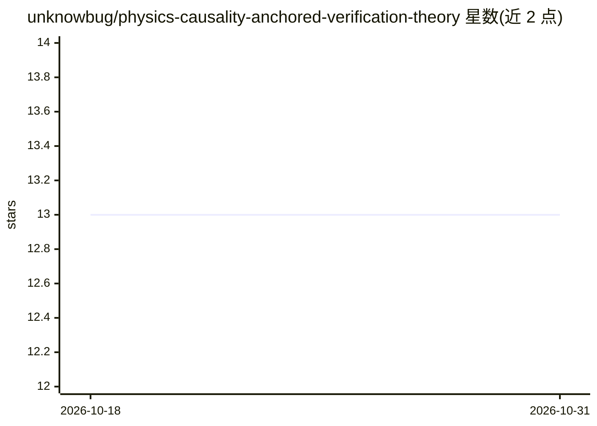

# unknowbug/physics-causality-anchored-verification-theory

⭐ 13 · Python · NOASSERTION · 推送 2026-10-08 · [GitHub](https://github.com/unknowbug/physics-causality-anchored-verification-theory) · 组织维护 · 中文 README

**以中文符号系统为常量的形式化范畴推导方法论（PCAVT）**

一套名为“唯物实践论/PCAVT”的形式化推导系统：将整个中文符号系统声明为 B1 常量集后进行范畴推导，产出三律结构条件、A-B-C 六子集框架、A2-A1 差值分析及对西哲与社会理论的范畴错位诊断。仓库提供中文系统提示词（v7）、基石声明、案例与第五版论著，并附一次全文英文翻译尝试的接口草稿；README 声明等价英文翻译在结构上不可能，建议英文读者将中文系统提示词交给可读中文的 LLM 进行分析。采用 CC BY-SA 4.0 许可。

## 筛选速览

| 维度 | 判定 | 备注 |
|---|---|---|
| AI 角色 | `ai-knowledge` | 知识聚合/清单类 |
| 许可风险 | `none` | NOASSERTION |
| 部署形态 | `None` |  |
| 模型依赖 | — | README 未给出锁定关系 |
| 硬件要求 | — | 无带数字的原话,不猜 |
| 安装摩擦 | `low` | 无编译、无系统依赖或容器化 |
| 成熟度 | — | 结构信号不足 |

## 能力要点

- 三律与 A-B-C 六子集框架的形式化范畴推导
- A2 - A1 差值分析用于测量文明生命体征
- 提供 LLM 系统提示词（v7）作为 AI 辅助分析入口
- 含等价翻译不可能性的形式化声明与一次英文接口译本记录

## 适用场景

- 用系统提示词让 LLM 以该框架分析具体问题
- 查阅对西哲、经济学与社会理论的范畴错位诊断案例
- 研究携带 A 层残余的符号系统与翻译不可能性论证

## 场景标签

 · 领域:哲学/方法论

## 证据(README 行号)

> L30: 1. **中文读者从系统提示词入手** → `core/唯物实践论_SYSTEM_PROMPT_v7.md`
> L118: > **Give the Chinese system prompt (`core/唯物实践论_SYSTEM_PROMPT_v7.md`) to a capable large language model (LLM) that

## 星数曲线

2026-10-18 13 → 2026-10-31 13（+0）

---
*卡片 v1 · prompt 1.4 · 生成 2026-10-31 · 置信度 mid · 依据 README sha `0e1bc8c5b604` · [字段定义](../../DATASET.md)*
