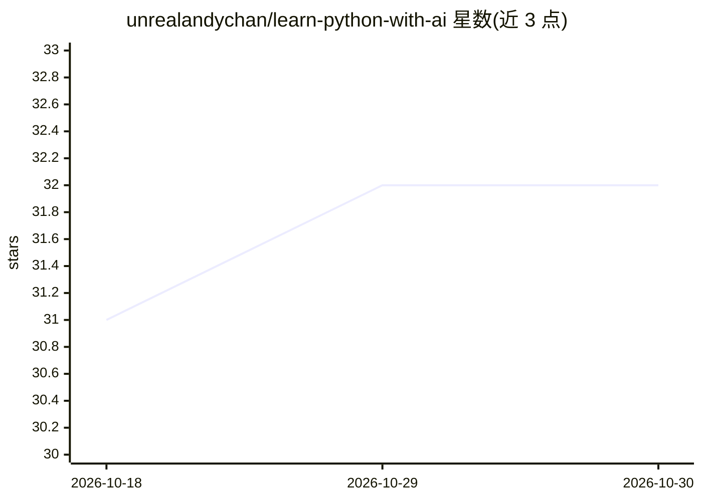

# unrealandychan/learn-python-with-ai

⭐ 32 · Python · MIT · 推送 2026-05-15 · [GitHub](https://github.com/unrealandychan/learn-python-with-ai) · 个人维护 · 中文 README

**面向 AI 应用开发的 Python 自学课程（75 课）**

内容全部由 AI 生成的 Python 自学课程仓库：75 节课程分为 6 个模块（Python 基础、面向对象、进阶、数据结构与算法、常用库、AI/LLM 集成），每课含 instructions.md、exercise.py 与 solution.py。所有概念以 AI 开发为语境讲授（如用解析 LLM API 响应讲变量、用异步流式讲 async/await）。全部练习使用 mock AI 客户端运行，无需 API key，可选配置 OpenAI key 接入真实 API。需 Python 3.11+，通过 git clone 获取并 pip 安装依赖。

## 筛选速览

| 维度 | 判定 | 备注 |
|---|---|---|
| AI 角色 | `ai-knowledge` | 知识聚合/清单类 |
| 许可风险 | `permissive` | MIT |
| 部署形态 | `library` | 以包/库形式分发 |
| 模型依赖 | — | README 未给出锁定关系 |
| 硬件要求 | — | 无带数字的原话,不猜 |
| 安装摩擦 | `low` | 无编译、无系统依赖或容器化 |
| 成熟度 | — | 结构信号不足 |

## 能力要点

- 75 节课程组织为 6 个模块，每课含说明、练习与答案三个文件
- 所有练习通过 mock AI 客户端运行，无需 API key
- 覆盖 OpenAI SDK、LangChain、FastAPI、Pandas、NumPy 等技术栈
- 课程内容全部由 AI 生成

## 适用场景

- 零基础学习者按 15 周路径系统自学 Python
- 希望用 Python 构建 AI 应用的开发者入门
- 准备编码面试复习数据结构与算法

## 场景标签

`教程课程` · 领域:学习与行业

## 证据(README 行号)

> L9: # 🤖 The Only Python Course You Need in the AI Era
> L15: > **75 lessons. Zero prerequisites. One goal: make you a Python developer who builds real AI applications.**
> L93: > 75 lessons organised into 6 modules. Each lesson has `instructions.md`, `exercise.py`, and `solution.py`.

## 星数曲线

2026-10-18 31 → 2026-10-30 32（+1）

---
*卡片 v1 · prompt 1.4 · 生成 2026-10-26 · 置信度 high · 依据 README sha `beb5f6a06cb3` · [字段定义](../../DATASET.md)*
