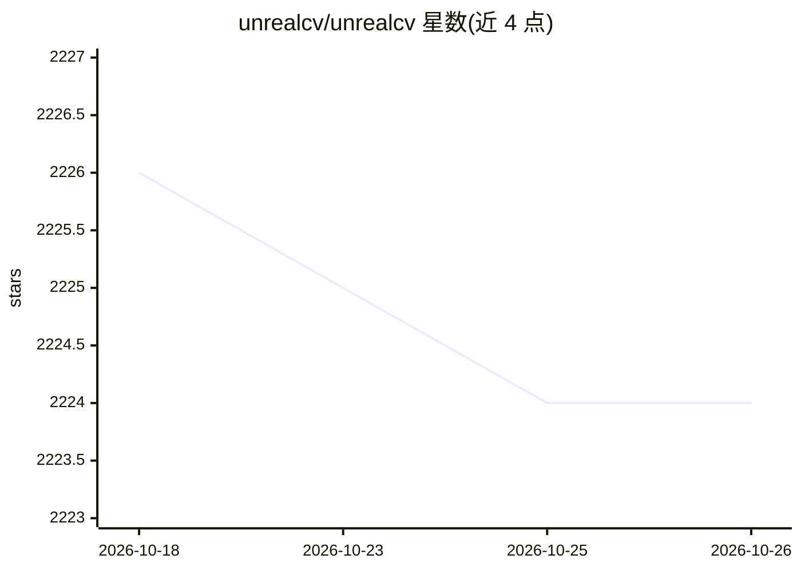

# unrealcv/unrealcv

⭐ 2,224 · Python · MIT · 推送 2026-09-04 · [GitHub](https://github.com/unrealcv/unrealcv) · [官网](https://unrealcv.org) · 组织维护

**给计算机视觉研究者的 Unreal Engine 插件：构建虚拟世界生成合成数据**

UnrealCV 是一个将虚幻引擎（UE）扩展为计算机视觉研究平台的插件：提供一组 UnrealCV 命令与外部程序（如 PyTorch/TensorFlow）的通信通道，用于在虚拟世界中交互、采集图像与标注。支持 UE 5.2 及以上、光流图像捕获、从 Python 调用任意 Blueprint 函数、Linux 下 RPC 通信。可通过预编译游戏二进制或 UE 插件两种方式使用；服务端需将源码放入 C++ UE 项目的 Plugin 目录用 Visual Studio 编译，客户端用 pip 安装。部分 Runtime MCP 功能未开源。

## 筛选速览

| 维度 | 判定 | 备注 |
|---|---|---|
| AI 角色 | `ai-ecosystem` | LLM/agent 周边工具 |
| 许可风险 | `permissive` | MIT |
| 部署形态 | `library` | 以包/库形式分发 |
| 模型依赖 | — | README 未给出锁定关系 |
| 硬件要求 | — | 无带数字的原话,不猜 |
| 安装摩擦 | `low` | 无编译、无系统依赖或容器化 |
| 成熟度 | — | 结构信号不足 |

## 能力要点

- 提供 UnrealCV 命令系统与 UE↔外部程序（PyTorch/TensorFlow）通信
- 支持 UE 5.2+、光流图像捕获、Python 调用 Blueprint 函数
- 支持 Linux 下 Server-Client RPC 通信
- Runtime MCP 客户端、示例与 agent skill 在 unrealcv-runtime-mcp 提供（C++ 服务端未开源）

## 适用场景

- 计算机视觉研究者在虚拟世界中采集带标注的合成图像数据
- 构建用于视觉算法测试的 UE 虚拟环境
- 通过 Python 客户端控制 UE 相机与物体

## 场景标签

 · 领域:计算机视觉/仿真

## 证据(README 行号)

> L7: UnrealCV is a project to help computer vision researchers build virtual worlds using Unreal Engine (UE). It extends 
> L9: 1. A set of UnrealCV commands to interact with the virtual world.
> L10: 2. Communication between UE and an external program, such as Pytorch/Tensorflow.

## 星数曲线

2026-10-18 2,226 → 2026-10-26 2,224（-2）

---
*卡片 v1 · prompt 1.4 · 生成 2026-10-21 · 置信度 high · 依据 README sha `bd5b6b100c1e` · [字段定义](../../DATASET.md)*
