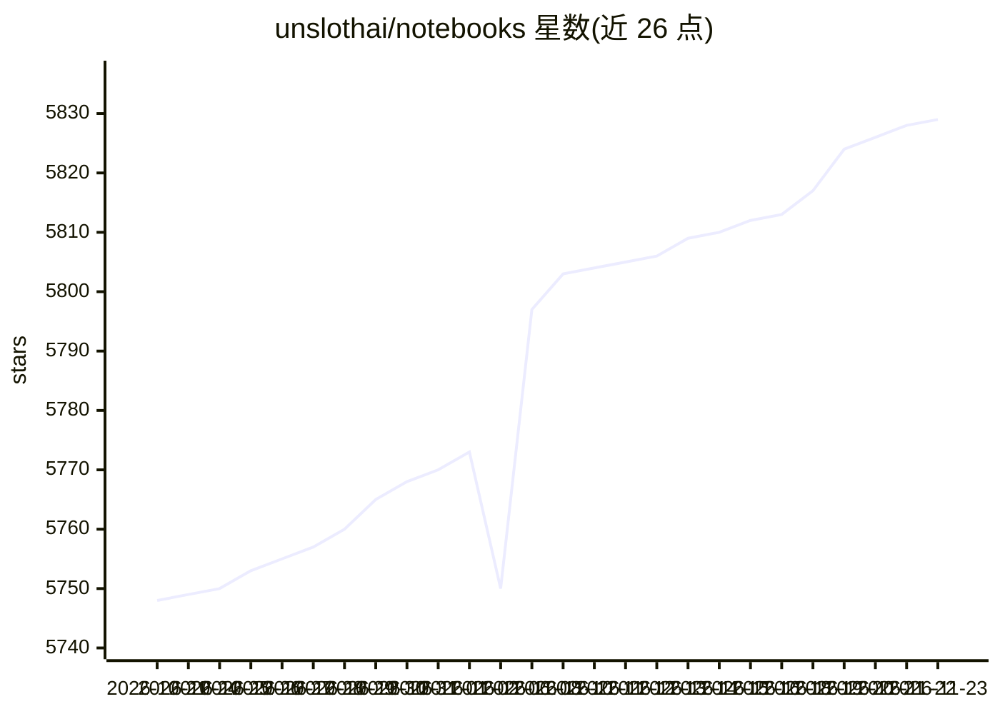

# unslothai/notebooks

⭐ 5,829 · Jupyter Notebook · LGPL-3.0 · 推送 2026-11-22 · [GitHub](https://github.com/unslothai/notebooks) · [官网](https://unsloth.ai/docs) · 组织维护

**面向模型微调者的 250+ Unsloth 微调与强化学习 Colab 笔记本集合**

Unsloth 维护的笔记本清单，按模型家族组织（Gemma、Qwen、Llama、Mistral、gpt-oss 等 250+ 个），覆盖文本、视觉、音频、嵌入、TTS 任务，类型包括对话微调、Alpaca、GRPO/DPO/PPO/ORPO 强化学习、工具调用、OCR、STT 等。每个笔记本在 Colab 中打开即可运行，内容含数据准备、训练与推理，也可在本地运行。

## 筛选速览

| 维度 | 判定 | 备注 |
|---|---|---|
| AI 角色 | `ai-knowledge` | 知识聚合/清单类 |
| 许可风险 | `viral` | LGPL-3.0 |
| 部署形态 | `None` |  |
| 模型依赖 | local-ok | 支持本地模型 |
| 硬件要求 | — | 无带数字的原话,不猜 |
| 安装摩擦 | `low` | 无编译、无系统依赖或容器化 |
| 成熟度 | — | 结构信号不足 |

## 能力要点

- 250+ 个按模型家族分类的 Colab 微调笔记本
- 覆盖 GRPO/DPO/PPO/ORPO 等强化学习训练类型
- 任务范围含文本、视觉、音频、嵌入、TTS、OCR、STT
- 笔记本含数据准备、训练与推理完整流程，可本地运行

## 适用场景

- 在 Colab 上微调 Qwen、Gemma、Llama 等开源模型
- 用 GRPO 笔记本对模型做数学/游戏类强化学习
- 为 TTS、OCR、嵌入模型找现成的微调示例

## 场景标签

`微调` `强化学习` `教程课程` · 领域:学习与行业

## 证据(README 行号)

> L6: ## 📒 Fine-tuning Notebooks
> L7: Below are Colab notebooks, organized by model. You can also view all notebooks in our docs. The notebooks run locall

## 星数曲线

2026-10-21 5,748 → 2026-11-23 5,829（+81）

---
*卡片 v1 · prompt 1.4 · 生成 2026-11-22 · 置信度 high · 依据 README sha `82a0fe63215f` · [字段定义](../../DATASET.md)*
