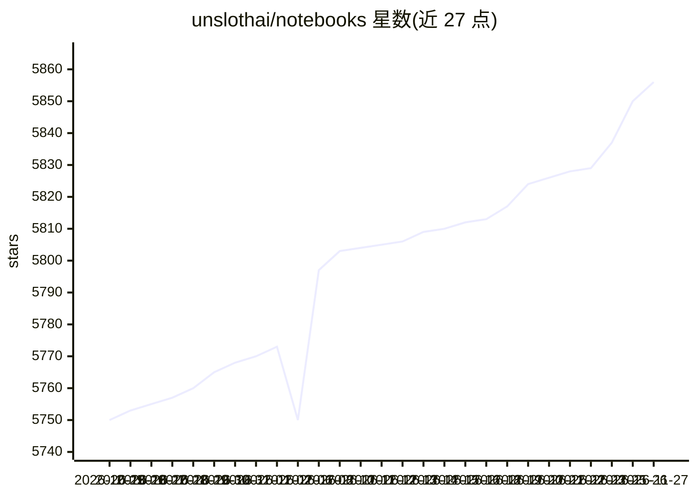

# unslothai/notebooks

⭐ 5,856 · Jupyter Notebook · LGPL-3.0 · 推送 2026-11-26 · [GitHub](https://github.com/unslothai/notebooks) · [官网](https://unsloth.ai/docs) · 组织维护

**250+ 模型微调与强化学习 Colab 笔记本集合，按模型分类**

Unsloth 维护的微调与 RL 笔记本仓库：按模型（Gemma、Qwen、Llama、Mistral、gpt-oss、DeepSeek、Phi 等）分类收录 250+ 个 Colab 笔记本，覆盖文本、视觉、音频、嵌入、TTS 等类型，任务类型包括对话微调、Alpaca、GRPO/DPO/PPO/ORPO/DAPO 强化学习、工具调用、OCR、分类等。每个笔记本含数据准备、训练与推理环节，可在 Colab 打开，也可本地运行。另有部分笔记本标注 A100/DGX Spark 等运行环境。

## 筛选速览

| 维度 | 判定 | 备注 |
|---|---|---|
| AI 角色 | `ai-knowledge` | 知识聚合/清单类 |
| 许可风险 | `viral` | LGPL-3.0 |
| 部署形态 | `None` |  |
| 模型依赖 | local-ok | 支持本地模型 |
| 硬件要求 | — | 无带数字的原话,不猜 |
| 安装摩擦 | `low` | 无编译、无系统依赖或容器化 |
| 成熟度 | — | 结构信号不足 |

## 能力要点

- 250+ 个按模型分类组织的 Colab 微调/RL 笔记本
- 覆盖文本、视觉、音频、嵌入、TTS、STT、OCR 等模态
- 包含 GRPO、DPO、PPO、ORPO、DAPO 等强化学习任务笔记本
- 笔记本含数据准备、训练与推理流程，支持 Colab 打开或本地运行

## 适用场景

- 为指定模型（如 Qwen3、Llama3、Gemma3）找现成的微调笔记本
- 学习 GRPO 等强化学习训练流程
- 微调 TTS、OCR、嵌入等特定任务模型
- 在 Colab 中跑通数据准备到推理的完整流程

## 场景标签

`微调` `强化学习` `教程课程` · 领域:学习与行业

## 证据(README 行号)

> L6: ## 📒 Fine-tuning Notebooks
> L7: Below are Colab notebooks, organized by model. You can also view all notebooks in our docs. The notebooks run locall

## 星数曲线

2026-10-25 5,750 → 2026-11-27 5,856（+106）

---
*卡片 v1 · prompt 1.4 · 生成 2026-11-26 · 置信度 high · 依据 README sha `3aa4c024b077` · [字段定义](../../DATASET.md)*
