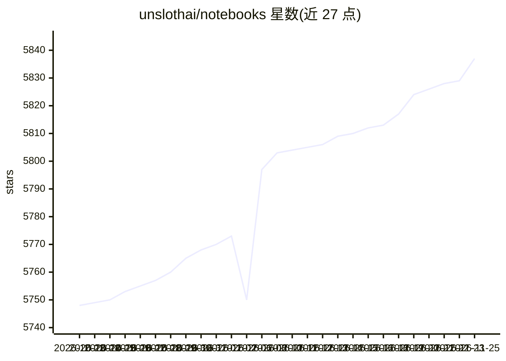

# unslothai/notebooks

⭐ 5,837 · Jupyter Notebook · LGPL-3.0 · 推送 2026-11-23 · [GitHub](https://github.com/unslothai/notebooks) · [官网](https://unsloth.ai/docs) · 组织维护

**面向开发者的 250+ 模型微调与强化学习 Colab 笔记本集**

unslothai 维护的笔记本集合，按模型（Gemma/Llama/Qwen/Mistral/gpt-oss 等）与任务类型组织，覆盖文本、视觉、音频、嵌入、TTS、OCR 等类别，训练方式包括 Alpaca 微调、GRPO/PPO/DPO/ORPO 强化学习、工具调用与知识蒸馏。笔记本以 Colab 链接形式提供，README 说明其可在本地运行，内容涵盖数据准备、训练与推理环节。

## 筛选速览

| 维度 | 判定 | 备注 |
|---|---|---|
| AI 角色 | `ai-knowledge` | 知识聚合/清单类 |
| 许可风险 | `viral` | LGPL-3.0 |
| 部署形态 | `None` |  |
| 模型依赖 | local-ok | 支持本地模型 |
| 硬件要求 | — | 无带数字的原话,不猜 |
| 安装摩擦 | `low` | 无编译、无系统依赖或容器化 |
| 成熟度 | — | 结构信号不足 |

## 能力要点

- 250+ 按模型与任务组织的 Colab 笔记本
- 覆盖 GRPO/PPO/DPO/ORPO 等强化学习与多种微调方式
- 文本、视觉、音频、嵌入、TTS、OCR 多模态任务覆盖
- 每个笔记本含数据准备、训练与推理环节

## 适用场景

- 我想在 Colab 上微调某个开源模型（如 Llama、Gemma、Qwen）
- 我想按 GRPO/PPO 等强化学习方法训练模型
- 我想微调 TTS、OCR 或嵌入模型

## 场景标签

`微调` `强化学习` `教程课程` · 领域:学习与行业

## 证据(README 行号)

> L6: ## 📒 Fine-tuning Notebooks
> L7: Below are Colab notebooks, organized by model. You can also view all notebooks in our docs. The notebooks run locall
> L10: |Model|Type|Notebook Link|

## 星数曲线

2026-10-23 5,748 → 2026-11-25 5,837（+89）

---
*卡片 v1 · prompt 1.4 · 生成 2026-11-24 · 置信度 high · 依据 README sha `0d2588f230ee` · [字段定义](../../DATASET.md)*
