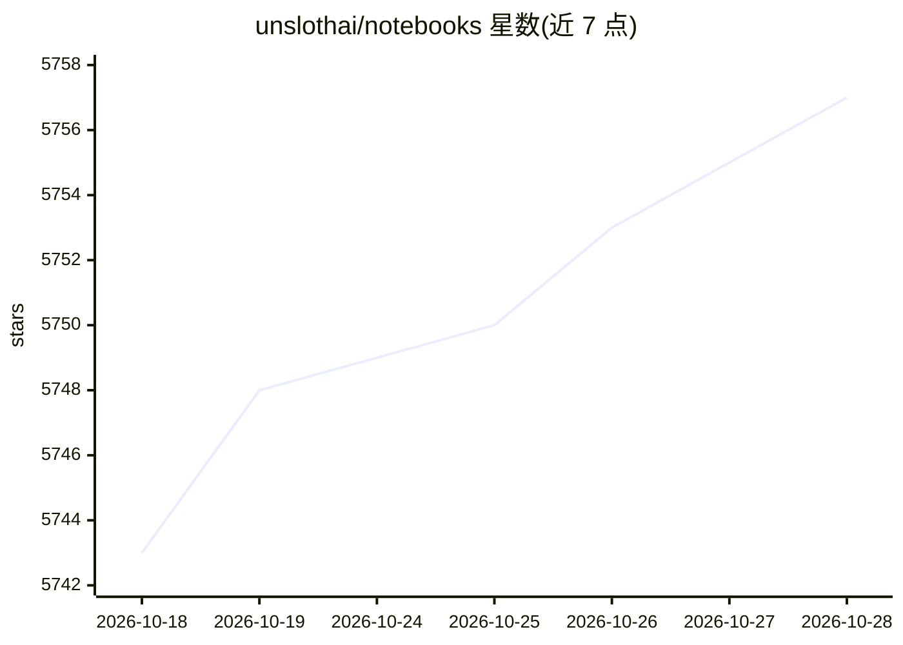

# unslothai/notebooks

⭐ 5,757 · Jupyter Notebook · LGPL-3.0 · 推送 2026-10-26 · [GitHub](https://github.com/unslothai/notebooks) · [官网](https://unsloth.ai/docs) · 组织维护

**250+ 模型微调与强化学习 Jupyter Notebook 集合（Colab）**

Unsloth 维护的微调与 RL Notebook 仓库：按模型（Gemma、Qwen、Llama、Mistral、Phi、gpt-oss、DeepSeek OCR 等）和任务类型（对话、视觉、音频、嵌入、TTS/STT、OCR、GRPO/PPO/DPO 等 RL）组织的 Colab Notebook 索引，覆盖数据准备、训练与推理流程，支持本地运行。面向希望用 Unsloth 微调开源模型的开发者与科研用户。限制：README 仅为表格化清单，不含安装命令或代码实现本体。

## 筛选速览

| 维度 | 判定 | 备注 |
|---|---|---|
| AI 角色 | `ai-knowledge` | 知识聚合/清单类 |
| 许可风险 | `viral` | LGPL-3.0 |
| 部署形态 | `None` |  |
| 模型依赖 | — | README 未给出锁定关系 |
| 硬件要求 | — | 无带数字的原话,不猜 |
| 安装摩擦 | `low` | 无编译、无系统依赖或容器化 |
| 成熟度 | — | 结构信号不足 |

## 能力要点

- 覆盖文本、视觉、音频、嵌入、TTS、OCR 多类模型的 250+ 微调/RL Notebook
- 提供 GRPO/PPO/DPO/ORPO/DAPO 等强化学习训练 Notebook
- 部分 Notebook 标注 A100 / DGX Spark 硬件配置变体
- 含手机端部署（Phone Deployment）与知识蒸馏（Knowledge Distillation）主题

## 适用场景

- 查找特定开源模型（如 Qwen3、Gemma3、Llama3）的微调 Notebook
- 学习 GRPO/PPO 等强化学习方法在具体模型上的训练流程
- 按任务类型（嵌入、TTS、OCR、视觉数学）定位对应微调示例

## 场景标签

`微调` `强化学习` `教程课程` · 领域:学习与行业

## 证据(README 行号)

> L6: ## 📒 Fine-tuning Notebooks
> L7: Below are Colab notebooks, organized by model. You can also view all notebooks in our docs. The notebooks run locall

## 星数曲线

2026-10-18 5,743 → 2026-10-28 5,757（+14）

---
*卡片 v1 · prompt 1.4 · 生成 2026-10-20 · 置信度 high · 依据 README sha `042912a63486` · [字段定义](../../DATASET.md)*
