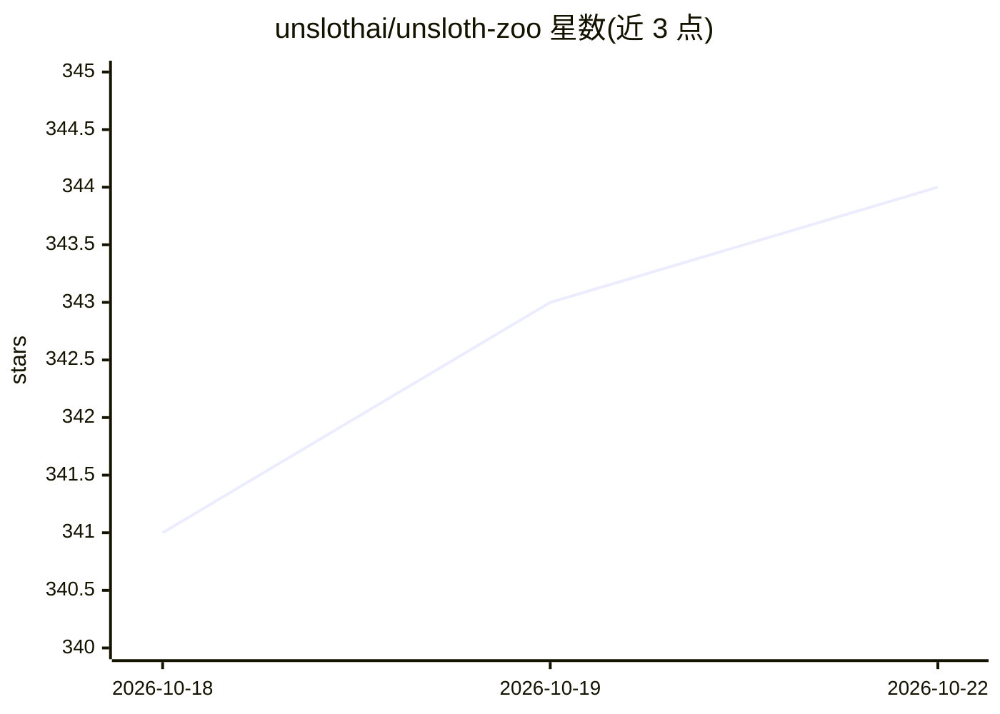

# unslothai/unsloth-zoo

⭐ 344 · Python · LGPL-3.0 · 推送 2026-10-21 · [GitHub](https://github.com/unslothai/unsloth-zoo) · [官网](https://unsloth.ai/) · 组织维护

**Unsloth 的辅助工具库：支撑 LLM 高效微调与导出**

unslothai/unsloth-zoo 是 Unsloth 微调框架的配套工具仓库。Unsloth 面向希望在消费级 GPU 上微调大模型的开发者，支持 gpt-oss、Gemma 3n、Qwen3、Llama 4、Mistral 等模型的微调、强化学习（GRPO/DPO/PPO 等）与预训练，采用 Triton 编写内核与手写反向传播引擎，宣称降低显存占用；微调后模型可导出为 GGUF 或部署到 Ollama、vLLM、Hugging Face。本仓库 README 主要承载 Unsloth 的安装与使用说明，提供 pip、conda、Docker 安装途径，要求 NVIDIA GPU（CUDA 能力 7.0 以上）与 PyTorch。

## 筛选速览

| 维度 | 判定 | 备注 |
|---|---|---|
| AI 角色 | `ai-ecosystem` | LLM/agent 周边工具 |
| 许可风险 | `viral` | LGPL-3.0 |
| 部署形态 | `self-host` | docker 或自建部署 |
| 模型依赖 | — | README 未给出锁定关系 |
| 硬件要求 | — | 无带数字的原话,不猜 |
| 安装摩擦 | `low` | 无编译、无系统依赖或容器化 |
| 成熟度 | — | 结构信号不足 |

## 能力要点

- 支持 gpt-oss/Gemma 3n/Qwen3/Llama 4/Mistral 等模型的微调与 GRPO/DPO/PPO 强化学习
- 内核以 Triton 编写并采用手写反向传播引擎
- 微调模型可导出 GGUF、Ollama、vLLM 或 Hugging Face
- 提供 pip/conda/Docker 安装途径，支持 Linux 与 Windows

## 适用场景

- 在本地 GPU 上低显存微调开源大模型
- 用 GRPO 训练推理型模型
- 将微调后的模型导出 GGUF 供 llama.cpp/Ollama 使用

## 场景标签

 · 领域:LLM 训练/微调工具

## 证据(README 行号)

> L6: ### Unsloth Zoo - Utils for Unsloth! Finetune gpt-oss, Gemma 3n, Qwen3, Llama 4, & Mistral 2x faster with 80% less V
> L77: - All kernels written in OpenAI's Triton language. **Manual backprop engine**.

## 星数曲线

2026-10-18 341 → 2026-10-22 344（+3）

---
*卡片 v1 · prompt 1.4 · 生成 2026-10-21 · 置信度 high · 依据 README sha `2138b98947e2` · [字段定义](../../DATASET.md)*
