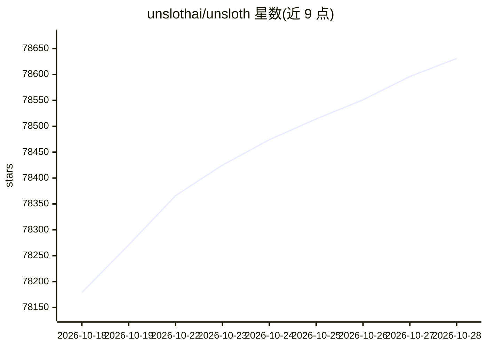

# unslothai/unsloth

⭐ 78,631 · Python · Apache-2.0 · 推送 2026-10-27 · [GitHub](https://github.com/unslothai/unsloth) · [官网](https://unsloth.ai/docs) · 组织维护

**在本地运行和微调 LLM 与扩散模型的桌面应用**

Unsloth 提供三种使用形态：桌面应用（Unsloth Desktop）、Web UI（Unsloth Studio）与代码库（Unsloth Core）。功能覆盖本地运行与训练 LLM、GGUF、MLX、扩散、嵌入、音频等模型；微调支持 LoRA、QLoRA、GRPO、DPO、FP8 等；提供 OpenAI 兼容 API、RAG/搜索、LAN 与 Cloudflare 远程访问；通过 unsloth start 一条命令将 Claude Code、Codex 等 agent 接到本地模型。支持 Windows/macOS/Linux，含 Docker 镜像与免费 Colab 类 notebook。

## 筛选速览

| 维度 | 判定 | 备注 |
|---|---|---|
| AI 角色 | `ai-native` | 本体是模型或模型工具 |
| 许可风险 | `permissive` | Apache-2.0 |
| 部署形态 | `self-host` | docker 或自建部署 |
| 模型依赖 | local-ok | 支持本地模型 |
| 硬件要求 | — | 无带数字的原话,不猜 |
| 安装摩擦 | `low` | 无编译、无系统依赖或容器化 |
| 成熟度 | — | 结构信号不足 |

## 动量与使用信号

- 维护:`active` — 距上次 push 0.9 天,年发版 59,408 位贡献者
- 涨星:近 1 天 **+79**(自 20261016 起算)
- 安装:pypi 包 `unsloth` 月下载 885,608
- 平台:WINDOWS / MACOS / LINUX · 协议:OPENAI-API / MCP

## 能力要点

- 运行与训练 LLM、GGUF、MLX、扩散、嵌入、音频模型
- 微调支持 RL、LoRA、QLoRA、GRPO、DPO、FP8，导出 GGUF/NVFP4/FP8
- unsloth start 命令连接 Claude Code、Codex、MCP 等本地 agent
- 提供 OpenAI 兼容 API、RAG、LAN/Cloudflare 远程访问

## 适用场景

- 在本地桌面运行和微调大模型
- 把 Claude Code/Codex 等 agent 接入本地模型
- 从 PDF/CSV/DOCX 构建数据集并训练模型
- 在局域网或远程安全访问本地模型服务

## 场景标签

`微调` `模型量化` `强化学习` · 领域:训练与推理

## 证据(README 行号)

> L6: Unsloth is the first desktop app to run and train models.
> L78: * Run and train LLMs, MLX, GGUF, diffusion, decision, embedding, audio models: Qwen3.8, GLM-5.3-Flash, Kimi K3, Qwe
> L86: * **Fine-tuning:** Train LLMs, diffusion, decision, TTS, and embedding models 2× faster with 70% less VRAM with no 

## 星数曲线

2026-10-18 78,179 → 2026-10-28 78,631（+452）

---
*卡片 v1 · prompt 1.4 · 生成 2026-10-18 · 置信度 high · 依据 README sha `784e42fd7095` · [字段定义](../../DATASET.md)*
