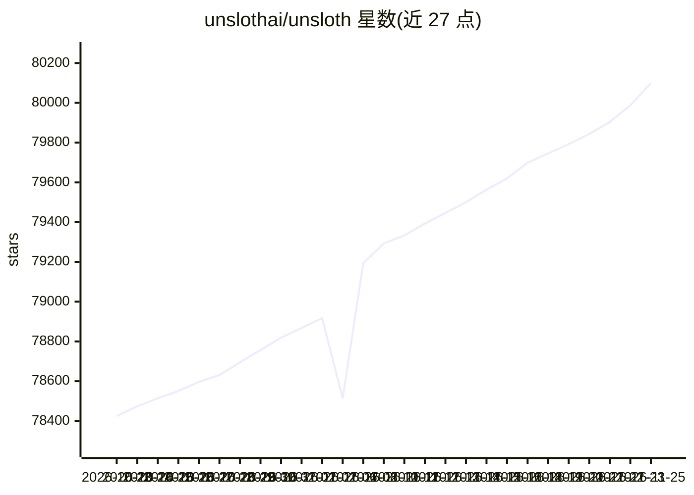

# unslothai/unsloth

⭐ 80,099 · Python · Apache-2.0 · 推送 2026-11-24 · [GitHub](https://github.com/unslothai/unsloth) · [官网](https://unsloth.ai/docs) · 组织维护

**本地桌面应用：运行与微调 LLM/扩散模型并提供 Web UI**

Unsloth 提供三种使用形态：Desktop 桌面应用（Windows/macOS/Linux 安装包）、Studio Web UI、Core 代码版（uv pip 安装）。功能覆盖本地运行与训练 LLM、GGUF、MLX、扩散、TTS、embedding 模型，支持 LoRA/QLoRA/GRPO/DPO/FP8 等训练方式与 GGUF/FP8 等导出格式；通过 unsloth start 命令把 Claude Code、Codex 等 agent 接到本地模型，并提供 OpenAI 兼容 API、RAG/搜索、LAN 与 Cloudflare HTTPS 远程访问、Docker 镜像部署。支持 NVIDIA/AMD/Intel GPU 与 CPU。

## 筛选速览

| 维度 | 判定 | 备注 |
|---|---|---|
| AI 角色 | `ai-ecosystem` | LLM/agent 周边工具 |
| 许可风险 | `permissive` | Apache-2.0 |
| 部署形态 | `self-host` | docker 或自建部署 |
| 模型依赖 | — | README 未给出锁定关系 |
| 硬件要求 | — | 无带数字的原话,不猜 |
| 安装摩擦 | `low` | 无编译、无系统依赖或容器化 |
| 成熟度 | — | 结构信号不足 |

## 动量与使用信号

- 维护:`active` — 距上次 push 0.9 天,年发版 59,408 位贡献者
- 涨星:近 1 天 **+79**(自 20261016 起算)
- 安装:pypi 包 `unsloth` 月下载 885,608
- 平台:WINDOWS / MACOS / LINUX · 协议:OPENAI-API / MCP

## 能力要点

- Desktop/Studio/Core 三种形态，覆盖 Windows/macOS/Linux 与 Docker 部署
- 训练支持 LoRA、QLoRA、GRPO、DPO、RL、FP8，导出 GGUF/NVFP4/FP8
- unsloth start 一条命令接入 Claude Code、Codex、VS Code 等 agent
- OpenAI 兼容 API、LAN/Cloudflare HTTPS 远程访问与密码管理

## 适用场景

- 在本地桌面运行 GGUF/MLX 模型并对话
- 用 notebooks 或 CLI 微调 LLM、TTS、视觉模型后导出部署
- 把本地模型作为 Claude Code/Codex 等 agent 的后端
- 通过 Docker 在服务器部署 Web UI 并远程访问

## 场景标签

`微调` `强化学习` `推理引擎` `RAG` · 领域:知识与检索

## 证据(README 行号)

> L6: Unsloth is the first desktop app to run and train models.
> L76: * Run and train LLMs, MLX, GGUF, diffusion, decision, embedding, audio models: Qwen3.8, GLM-5.3-Flash, Kimi K3, Qwe
> L87: * **Complete support:** Supports reinforcement learning, LoRA, QLoRA, full fine tuning, pretraining, RL, GRPO, DPO,

## 星数曲线

2026-10-23 78,425 → 2026-11-25 80,099（+1,674）

---
*卡片 v1 · prompt 1.4 · 生成 2026-11-24 · 置信度 high · 依据 README sha `87700781257f` · [字段定义](../../DATASET.md)*
