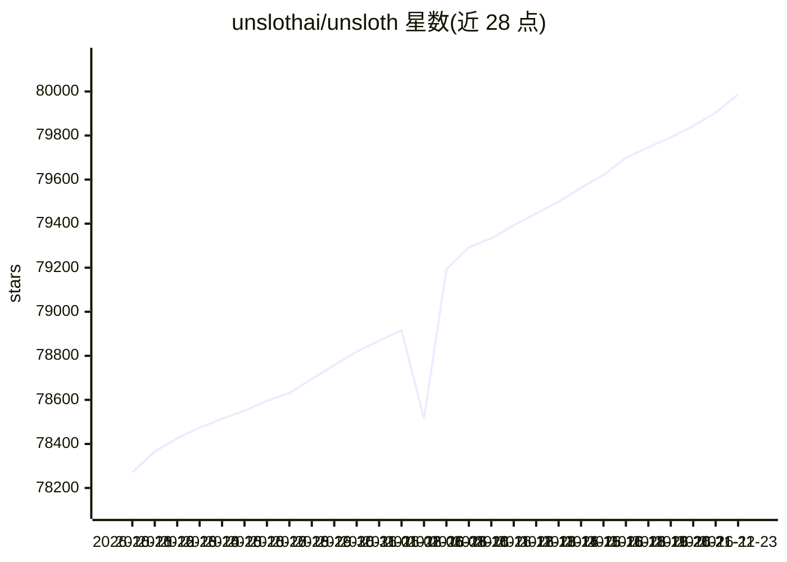

# unslothai/unsloth

⭐ 79,987 · Python · Apache-2.0 · 推送 2026-11-22 · [GitHub](https://github.com/unslothai/unsloth) · [官网](https://unsloth.ai/docs) · 组织维护

**本地运行与训练 LLM/扩散模型的桌面应用**

Unsloth 提供三种形态：Desktop 桌面应用、Studio Web UI 和 Core 代码版，用于在本地运行与训练 LLM、扩散、决策、嵌入、音频等模型，覆盖 Qwen、DeepSeek、Gemma、Kimi 等型号。训练侧支持 LoRA/QLoRA、GRPO/DPO 等，并导出 GGUF 等格式；推理侧提供 OpenAI 兼容 API、RAG、浏览器操作，以及通过 unsloth start 一条命令把 Claude Code、Codex 等 agent 接到本地模型。支持 Windows/macOS/Linux 安装包、Docker 镜像与 Homebrew/winget 安装。

## 筛选速览

| 维度 | 判定 | 备注 |
|---|---|---|
| AI 角色 | `ai-ecosystem` | LLM/agent 周边工具 |
| 许可风险 | `permissive` | Apache-2.0 |
| 部署形态 | `self-host` | docker 或自建部署 |
| 模型依赖 | local-ok | 支持本地模型 |
| 硬件要求 | — | 无带数字的原话,不猜 |
| 安装摩擦 | `low` | 无编译、无系统依赖或容器化 |
| 成熟度 | — | 结构信号不足 |

## 动量与使用信号

- 维护:`active` — 距上次 push 0.9 天,年发版 59,408 位贡献者
- 涨星:近 1 天 **+79**(自 20261016 起算)
- 安装:pypi 包 `unsloth` 月下载 885,608
- 平台:WINDOWS / MACOS / LINUX · 协议:OPENAI-API / MCP

## 能力要点

- 三种使用形态：Desktop 桌面应用、Studio Web UI、Core 代码版
- 支持 LoRA、QLoRA、GRPO、DPO、FP8 等训练方式，导出 GGUF/NVFP4/FP8
- unsloth start 一条命令将 Claude Code、Codex 等 agent 连接本地模型
- 多平台安装：安装包、install.sh 脚本、Docker、Homebrew、winget

## 适用场景

- 在本地电脑上运行开源 LLM 并通过 OpenAI 兼容 API 提供服务
- 微调 LLM 或扩散模型并导出 GGUF 部署
- 把 Claude Code/Codex 等 agent 接入本地模型
- 从 PDF/CSV/DOCX 构建训练数据集

## 场景标签

`微调` `强化学习` `RAG` `图像生成` · 领域:内容生成

## 证据(README 行号)

> L6: Unsloth is the first desktop app to run and train models.
> L80: * **Agents & Tools:** Use local models with Claude Code, Codex, and MCP, including tool calling and code execution.
> L115: Unsloth can be used in three ways: **Unsloth Desktop**, the desktop app; **Unsloth Studio**, the web UI; or **Unsl

## 星数曲线

2026-10-21 78,271 → 2026-11-23 79,987（+1,716）

---
*卡片 v1 · prompt 1.4 · 生成 2026-11-23 · 置信度 high · 依据 README sha `eff5f75e8e0a` · [字段定义](../../DATASET.md)*
