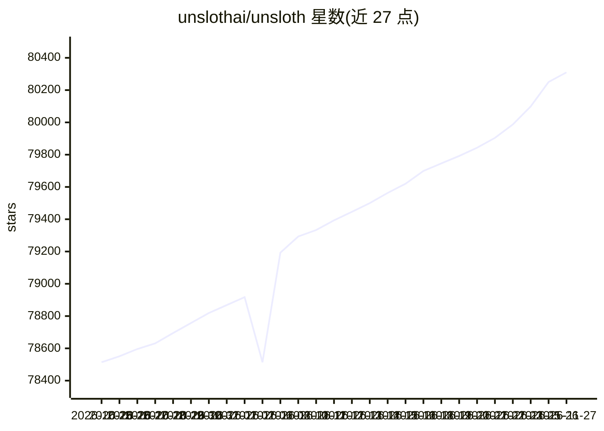

# unslothai/unsloth

⭐ 80,310 · Python · Apache-2.0 · 推送 2026-11-26 · [GitHub](https://github.com/unslothai/unsloth) · [官网](https://unsloth.ai/docs) · 组织维护

**本地运行与训练 LLM/扩散模型的桌面应用，供开发者与模型使用者**

提供三种使用形态：Desktop 桌面应用（Windows/macOS/Linux 安装包）、Studio Web UI、Core 代码库（pip 安装）。功能覆盖本地运行与训练 LLM、GGUF/MLX、扩散、嵌入、TTS 等模型，微调支持 LoRA/QLoRA/GRPO/DPO/FP8 等方法，导出 GGUF 等格式，并可通过 OpenAI 兼容 API 对外提供模型服务。可将本地模型接入 Claude Code、Codex、MCP 等 agent 工具，支持 Cloudflare HTTPS 远程与 LAN 访问，暴露服务时要求设置管理密码。

## 筛选速览

| 维度 | 判定 | 备注 |
|---|---|---|
| AI 角色 | `ai-ecosystem` | LLM/agent 周边工具 |
| 许可风险 | `permissive` | Apache-2.0 |
| 部署形态 | `self-host` | docker 或自建部署 |
| 模型依赖 | — | README 未给出锁定关系 |
| 硬件要求 | — | 无带数字的原话,不猜 |
| 安装摩擦 | `low` | 无编译、无系统依赖或容器化 |
| 成熟度 | — | 结构信号不足 |

## 动量与使用信号

- 维护:`active` — 距上次 push 0.9 天,年发版 59,408 位贡献者
- 涨星:近 1 天 **+79**(自 20261016 起算)
- 安装:pypi 包 `unsloth` 月下载 885,608
- 平台:WINDOWS / MACOS / LINUX · 协议:OPENAI-API / MCP

## 能力要点

- 桌面/Web UI/代码库三种形态，Windows、Linux、WSL、macOS 均可运行
- 运行与训练 LLM、扩散、决策、嵌入、音频模型，导出 GGUF、NVFP4、FP8 等格式
- unsloth start 命令将本地模型接入 Claude Code、Codex、OpenCode 等 agent
- 通过 OpenAI 兼容 API 服务模型，支持 LAN 与 Cloudflare HTTPS 远程访问

## 适用场景

- 在本地电脑运行开源 LLM 与图像/视频扩散模型
- 微调模型并导出 GGUF 等格式部署
- 把本地模型作为 Claude Code、Codex 等 agent 的后端
- 通过 Web UI 或局域网从多设备访问本地模型

## 场景标签

`图像生成` `语音合成` `微调` `模型量化` · 领域:内容生成

## 证据(README 行号)

> L6: Unsloth is the first desktop app to run and train models.
> L77: * **Agents & Tools:** Use local models with Claude Code, Codex, and MCP, including tool calling and code execution.
> L86: * **Fine-tuning:** Train LLMs, diffusion, decision, TTS, and embedding models 2× faster with 70% less VRAM with no 

## 星数曲线

2026-10-25 78,514 → 2026-11-27 80,310（+1,796）

---
*卡片 v1 · prompt 1.4 · 生成 2026-11-26 · 置信度 high · 依据 README sha `d71c6e8389ce` · [字段定义](../../DATASET.md)*
