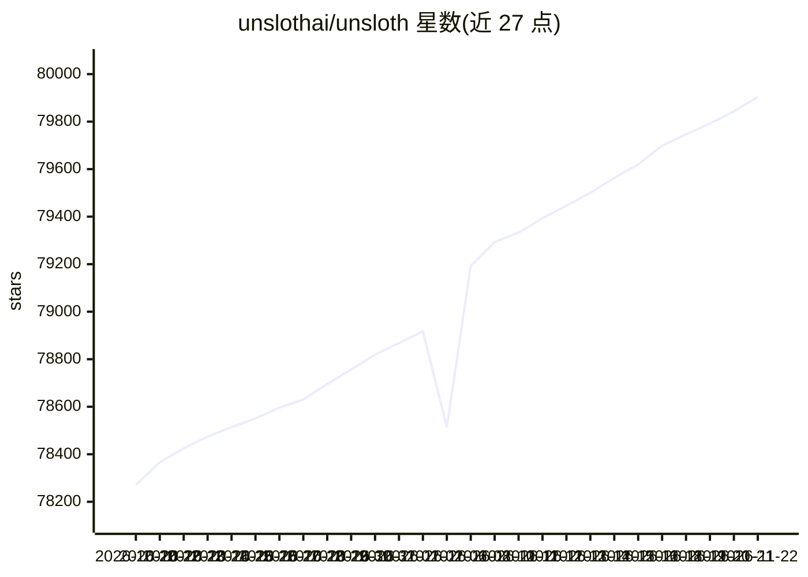

# unslothai/unsloth

⭐ 79,904 · Python · Apache-2.0 · 推送 2026-11-21 · [GitHub](https://github.com/unslothai/unsloth) · [官网](https://unsloth.ai/docs) · 组织维护

**桌面应用：本地运行并微调 LLM 与扩散模型**

Unsloth 提供三种使用形态：Desktop 桌面应用（Windows/macOS/Linux 安装包）、Studio Web UI 和 Core 代码库版本，用于本地运行与训练 LLM、GGUF、MLX、扩散、TTS、嵌入等模型。微调支持 LoRA/QLoRA/GRPO/DPO 等方法，并可导出 GGUF、FP8 等格式部署。通过 unsloth start 命令可将 Claude Code、Codex 等 agent 接入本地模型；提供 OpenAI 兼容 API、RAG、网页搜索与 LAN/远程 HTTPS 访问。支持 Docker 部署与免费训练 notebooks。

## 筛选速览

| 维度 | 判定 | 备注 |
|---|---|---|
| AI 角色 | `ai-ecosystem` | LLM/agent 周边工具 |
| 许可风险 | `permissive` | Apache-2.0 |
| 部署形态 | `self-host` | docker 或自建部署 |
| 模型依赖 | local-ok | 支持本地模型 |
| 硬件要求 | — | 无带数字的原话,不猜 |
| 安装摩擦 | `low` | 无编译、无系统依赖或容器化 |
| 成熟度 | — | 结构信号不足 |

## 动量与使用信号

- 维护:`active` — 距上次 push 0.9 天,年发版 59,408 位贡献者
- 涨星:近 1 天 **+79**(自 20261016 起算)
- 安装:pypi 包 `unsloth` 月下载 885,608
- 平台:WINDOWS / MACOS / LINUX · 协议:OPENAI-API / MCP

## 能力要点

- 运行与微调 LLM、GGUF、MLX、扩散、决策、嵌入、音频模型
- unsloth start 一条命令连接 Claude Code/Codex 等到本地模型
- OpenAI 兼容 API、RAG、网页搜索与 LAN/Cloudflare 远程访问
- 免费 notebooks 覆盖 GRPO、TTS、视觉等训练场景

## 适用场景

- 在本地桌面运行开源模型进行对话或图像生成
- 微调模型后导出 GGUF 等格式部署
- 让 Claude Code/Codex 等 agent 使用本地模型
- 通过局域网或远程 HTTPS 访问本地模型服务

## 场景标签

`微调` `强化学习` `推理引擎` `图像生成` · 领域:内容生成

## 证据(README 行号)

> L6: Unsloth is the first desktop app to run and train models.
> L80: * **Agents & Tools:** Use local models with Claude Code, Codex, and MCP, including tool calling and code execution.
> L89: * **Fine-tuning:** Train LLMs, diffusion, decision, TTS, and embedding models 2× faster with 70% less VRAM with no 

## 星数曲线

2026-10-20 78,271 → 2026-11-22 79,904（+1,633）

---
*卡片 v1 · prompt 1.4 · 生成 2026-11-22 · 置信度 high · 依据 README sha `6fe419123131` · [字段定义](../../DATASET.md)*
