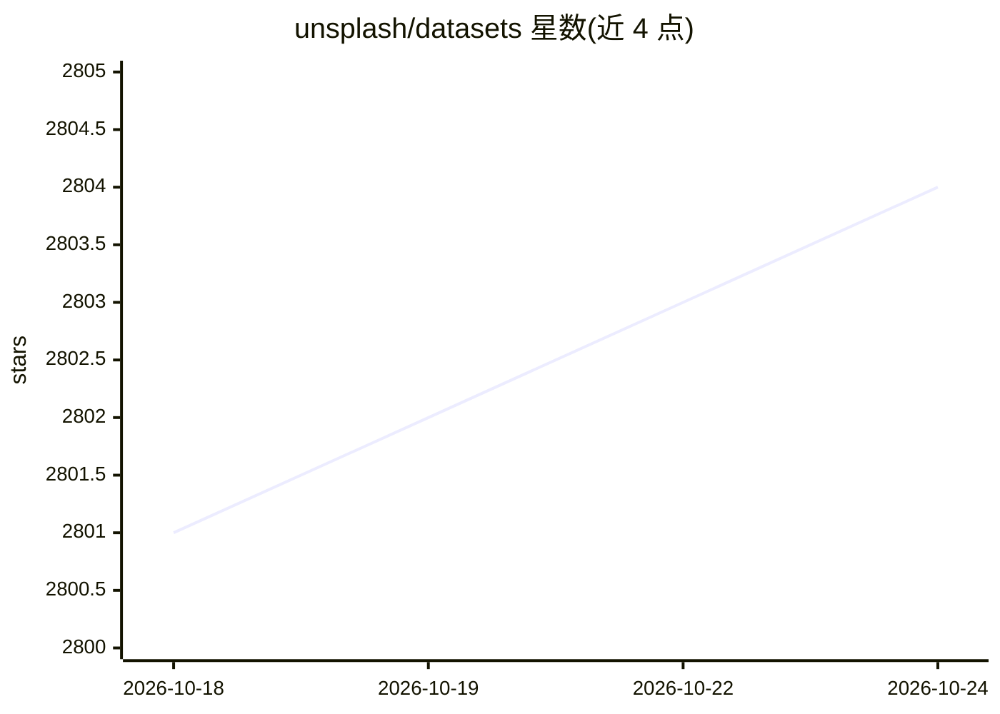

# unsplash/datasets

⭐ 2,805 · Jupyter Notebook · 推送 2026-06-26 · [GitHub](https://github.com/unsplash/datasets) · [官网](https://unsplash.com/data) · 组织维护

**面向研究与机器学习的 Unsplash 图片数据集（740万+照片）**

Unsplash 官方发布的图像与搜索行为数据集：由 41.5 万+摄影师贡献的照片元数据、关键词与搜索记录组成。分两个版本——Lite（约 2.5 万照片、3 万关键词、100 万搜索，可商用）与 Full（740 万+照片、160 万关键词、1.6 亿搜索，仅限非商用，需在官网申请，约 20GB 压缩）。提供 PostgreSQL 与 Python 环境的加载示例，版本语义化管理，限制为不可再分发图像。

## 筛选速览

| 维度 | 判定 | 备注 |
|---|---|---|
| AI 角色 | `ai-knowledge` | 知识聚合/清单类 |
| 许可风险 | `none` | — |
| 部署形态 | `None` |  |
| 模型依赖 | — | README 未给出锁定关系 |
| 硬件要求 | — | 无带数字的原话,不猜 |
| 安装摩擦 | `low` | 无编译、无系统依赖或容器化 |
| 成熟度 | — | 结构信号不足 |

## 能力要点

- 740 万+高质量照片元数据与 1.6 亿搜索记录（Full 版）
- Lite 版约 2.5 万照片，允许商业与非商业用途
- 提供 PostgreSQL / Python 加载示例文档

## 适用场景

- 训练或评测图像语义理解、搜索相关性模型
- 研究图像关键词与用户搜索意图的关联
- 学术研究中作为公开图像数据源（需引用版本号）

## 场景标签

 · 领域:计算机视觉/开放数据

## 证据(README 行号)

> L1: # The Unsplash Dataset
> L3: The Unsplash Dataset is made up of over 415,000+ contributing global photographers and data sourced from hundreds of
> L8: - the Full dataset: available for noncommercial usage, containing 7.4M+ high-quality Unsplash photos, 1.6M keywords,

## 星数曲线

2026-10-18 2,801 → 2026-10-24 2,804（+3）

---
*卡片 v1 · prompt 1.4 · 生成 2026-10-21 · 置信度 high · 依据 README sha `96f770e601f7` · [字段定义](../../DATASET.md)*
