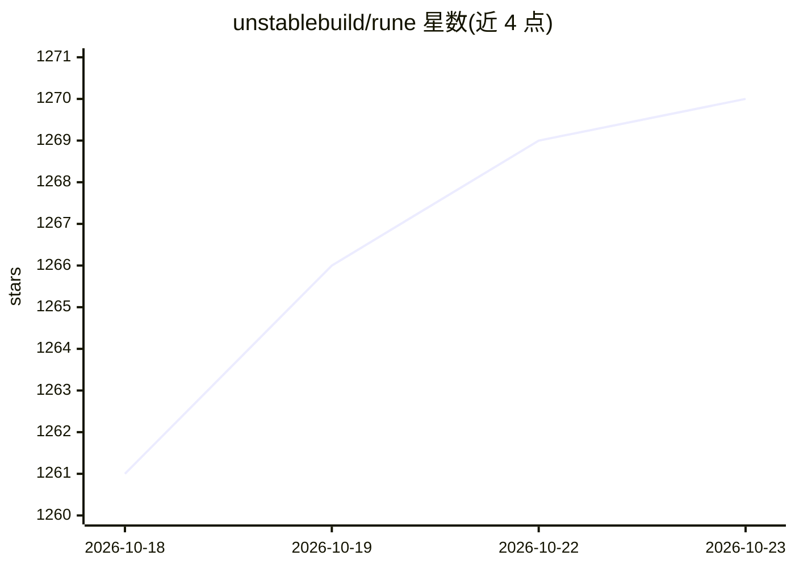

# unstablebuild/rune

⭐ 1,270 · Go · GPL-3.0 · 推送 2026-10-22 · [GitHub](https://github.com/unstablebuild/rune) · [官网](https://rune.build) · 组织维护

**GPU 加速的 IDE 与终端复用器，内置编程 agent**

Rune 是面向开发者的原生图形管线 IDE 与终端多路复用器，用 OpenGL（Linux）/Metal（macOS）渲染，提供九个工作区槽位、无限终端与标签页、生产级语言智能、插件包安装机制。内置 agent 并可为用户自己的 agent 提供 IDE 级技能，定位同时服务自动与手动编程。各实例通过端到端加密的 headscale 网络互联，可跨设备继续工作；支持 headless Docker 节点共享工作区。由 Unstable Build, LLC 开发，GPLv3 许可。

## 筛选速览

| 维度 | 判定 | 备注 |
|---|---|---|
| AI 角色 | `ai-enhanced` | 去掉 AI 部分产品仍成立 |
| 许可风险 | `viral` | GPL-3.0 |
| 部署形态 | `desktop` | 安装包/桌面程序 |
| 模型依赖 | — | README 未给出锁定关系 |
| 硬件要求 | — | 无带数字的原话,不猜 |
| 安装摩擦 | `low` | 无编译、无系统依赖或容器化 |
| 成熟度 | — | 结构信号不足 |

## 能力要点

- 内置 agent 与 IDE 级技能，支持自动与手动编程
- 多实例经端到端加密网络互联，跨设备接续工作
- 原生 OpenGL/Metal 图形管线，非 Electron
- 官方插件包与社区 Git 仓库插件安装

## 适用场景

- 在一个窗口内组织多终端、标签与工作区进行开发
- 跨设备远程接入自己的开发工作区
- 以 headless 节点向多台开发机共享项目工作区

## 场景标签

 · 领域:开发者工具/IDE

## 证据(README 行号)

> L16: **Rune is a fast, GPU-accelerated, full-featured IDE and terminal multiplexer, suitable both for automatic and manu
> L20: - **a new organizing model**: Stay in the flow for longer. Rune's UI is a screen multiplexer that allows you to org

## 星数曲线

2026-10-18 1,261 → 2026-10-23 1,270（+9）

---
*卡片 v1 · prompt 1.4 · 生成 2026-10-21 · 置信度 high · 依据 README sha `b059d22ecc1d` · [字段定义](../../DATASET.md)*
