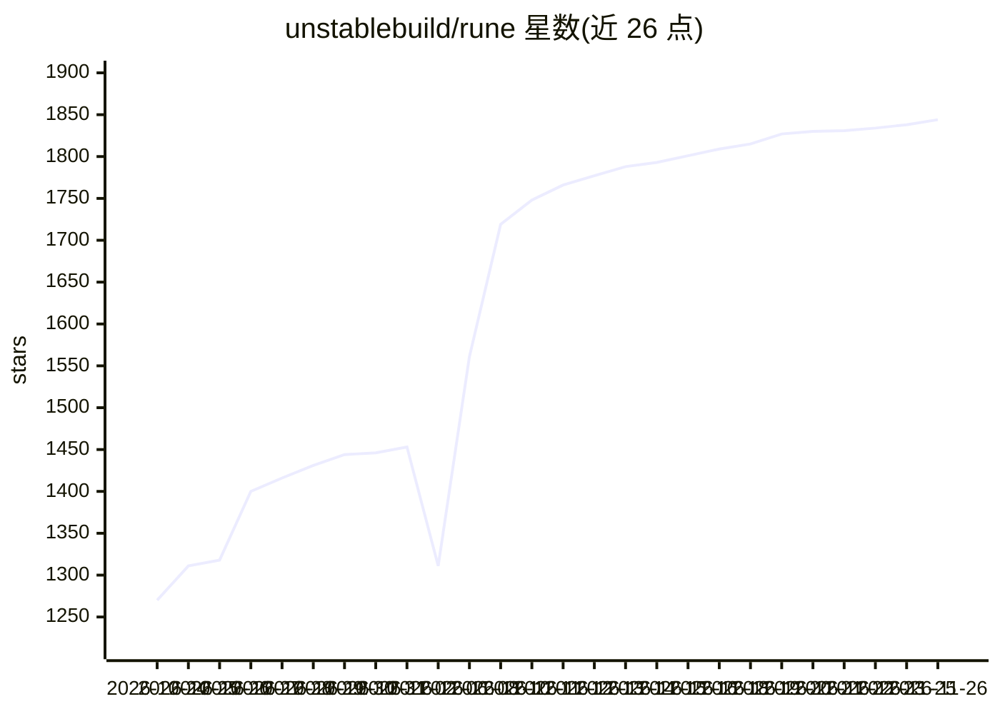

# unstablebuild/rune

⭐ 1,844 · Go · GPL-3.0 · 推送 2026-11-25 · [GitHub](https://github.com/unstablebuild/rune) · [官网](https://rune.build) · 组织维护

**面向开发者的 GPU 加速 IDE 与终端复用器，含内置 agent**

Rune 是一个用 Go 编写的原生图形应用（Linux 用 OpenGL、macOS 用 Metal，无 Electron），兼作 IDE 与终端复用器：提供九个工作区槽位、多终端/标签/窗口的屏幕复用 UI、开箱即用的语言智能、插件与扩展系统（可从 Git 仓库安装社区扩展包）。多个 Rune 实例通过 headscale 组成端到端加密的点对点网络，可跨设备连接工作区；支持 headless 模式以 Docker 部署工作区节点，并可用 systemd/launchd 等作为服务运行。

## 筛选速览

| 维度 | 判定 | 备注 |
|---|---|---|
| AI 角色 | `ai-enhanced` | 去掉 AI 部分产品仍成立 |
| 许可风险 | `viral` | GPL-3.0 |
| 部署形态 | `desktop` | 安装包/桌面程序 |
| 模型依赖 | — | README 未给出锁定关系 |
| 硬件要求 | — | 无带数字的原话,不猜 |
| 安装摩擦 | `low` | 无编译、无系统依赖或容器化 |
| 成熟度 | — | 结构信号不足 |

## 能力要点

- 原生图形管线：Linux 用 OpenGL、macOS 用 Metal，无 Electron
- 多实例组成 e2e 加密点对点网络，可从任意设备连接工作区
- 内置 agent 与 IDE 级 skills，语言包按需安装
- headless 模式经 Docker 部署，支持 systemd/launchd/OpenRC/runit 服务化

## 适用场景

- 在终端与 IDE 一体界面中组织多工作区、多终端开发环境
- 从笔记本远程连接工作站上的开发工作区
- 用 Docker 在服务器上托管 headless 工作区节点供多机接入

## 场景标签

 · 领域:开发者工具/IDE 与终端

## 证据(README 行号)

> L16: **Rune is a fast, GPU-accelerated, full-featured IDE and terminal multiplexer, suitable both for automatic and manu
> L20: - **a new organizing model**: Stay in the flow for longer. Rune's UI is a screen multiplexer that allows you to org

## 星数曲线

2026-10-24 1,270 → 2026-11-26 1,844（+574）

---
*卡片 v1 · prompt 1.4 · 生成 2026-11-23 · 置信度 mid · 依据 README sha `d265d4b37edc` · [字段定义](../../DATASET.md)*
