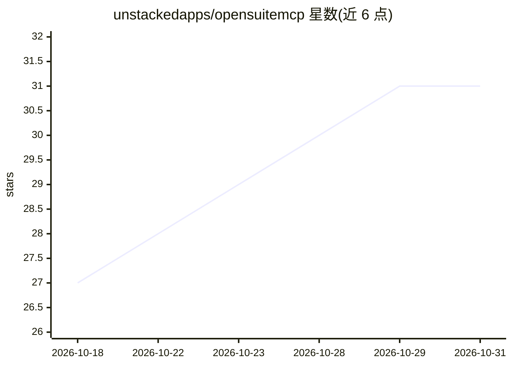

# unstackedapps/opensuitemcp

⭐ 31 · TypeScript · NOASSERTION · 推送 2026-10-27 · [GitHub](https://github.com/unstackedapps/opensuitemcp) · [官网](https://opensuitemcp.com) · 组织维护

**面向 NetSuite 的 MCP 客户端/服务器：用 AI 对话操作业务数据**

自托管的 NetSuite MCP 客户端，提供聊天 UI，接入 NetSuite AI Connector Service 与 MCP Standard Tools，可在对话中运行 SuiteQL、记录、报表、保存搜索等工具；自带角色（Personas）、四来源技能体系（Oracle/Community/Connected/Custom）与 Companion 提示词库。支持自带 LLM key（Gemini/Claude/OpenAI/OpenAI 兼容端点），也可作为 MCP 服务器让外部 agent 以用户身份操作 NetSuite 工作区。需 Node.js 22+ 与 Docker（本地 PostgreSQL/Redis/SearXNG），仅限内部使用自托管，商业权利由 Unstacked Apps 保留。

## 筛选速览

| 维度 | 判定 | 备注 |
|---|---|---|
| AI 角色 | `ai-native` | 本体是模型或模型工具 |
| 许可风险 | `none` | NOASSERTION |
| 部署形态 | `desktop` | 安装包/桌面程序 |
| 模型依赖 | locked-api |  |
| 硬件要求 | — | 无带数字的原话,不猜 |
| 安装摩擦 | `low` | 无编译、无系统依赖或容器化 |
| 成熟度 | — | 结构信号不足 |

## 能力要点

- 聊天中直接运行 NetSuite 的 SuiteQL、记录、报表、保存搜索等 MCP 工具
- 可作为 MCP 服务器，让外部 AI agent 以用户身份与权限操作 NetSuite 工作区（OAuth 2.1/DCR 或 Bearer 认证）
- 四来源技能体系（Oracle/Community/Connected/Custom）与角色（Personas）机制
- 自带 LLM key：支持 Gemini、Claude、OpenAI 及 OpenAI 兼容端点

## 适用场景

- 用对话方式查询和操作 NetSuite 业务数据
- 让外部 AI agent 以我的身份在 NetSuite 工作区内执行任务
- 通过内置专家角色与技能库定制业务助手

## 场景标签

`聊天机器人` `AI 助手` · 领域:对话与助手

## 证据(README 行号)

> L7: Source-available **NetSuite MCP client** — chat UI for NetSuite’s AI Connector Service, MCP Standard Tools, Companio
> L9: Bring your own LLM keys (**Google Gemini**, **Anthropic Claude**, **OpenAI**, or an **OpenAI-compatible** endpoint).
> L89: With AI Connector + MCP Standard Tools connected, chat can run SuiteQL, records, reports, saved searches, and relat

## 星数曲线

2026-10-18 27 → 2026-10-31 31（+4）

---
*卡片 v1 · prompt 1.4 · 生成 2026-10-26 · 置信度 high · 依据 README sha `cd7c9bca659f` · [字段定义](../../DATASET.md)*
