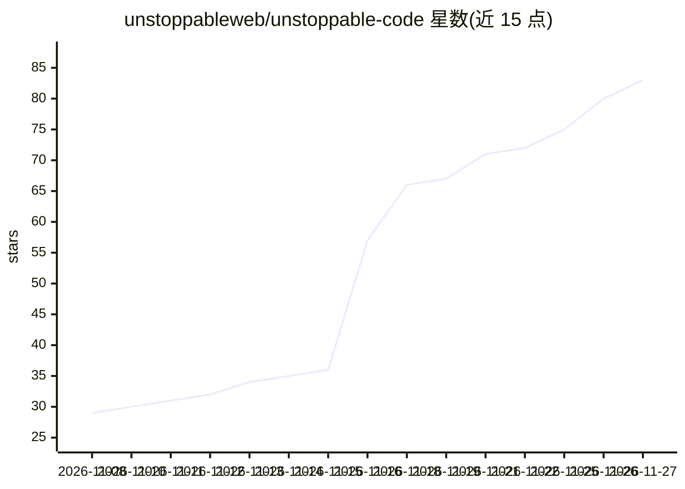

# unstoppableweb/unstoppable-code

⭐ 83 · TypeScript · MIT · 推送 2026-11-26 · [GitHub](https://github.com/unstoppableweb/unstoppable-code) · [官网](https://unstoppable.ai) · 组织维护

**把多个编码 agent 聚合到一个 IDE 的桌面/移动客户端**

面向使用编码 agent 的开发者的 AI IDE：将 Claude Code、Codex、Cursor 及本地模型聚合在一个应用中，可在流水线不同步骤选用不同提供商的模型，把提示、脚本与检查串成可复用工作流；支持每个任务独立 Git worktree 的并行 agent 工作、集成终端与浏览器，以及用移动 App 远程控制桌面。桌面与移动客户端以 MIT 许可发布，账号、AI 积分、云功能等托管服务闭源且不在本仓库；仓库不接受 pull request，且发布的是源码快照，可能滞后。

## 筛选速览

| 维度 | 判定 | 备注 |
|---|---|---|
| AI 角色 | `ai-ecosystem` | LLM/agent 周边工具 |
| 许可风险 | `permissive` | MIT |
| 部署形态 | `None` |  |
| 模型依赖 | — | README 未给出锁定关系 |
| 硬件要求 | — | 无带数字的原话,不猜 |
| 安装摩擦 | `low` | 无编译、无系统依赖或容器化 |
| 成熟度 | — | 结构信号不足 |

## 能力要点

- 聚合 Claude Code、Codex、Cursor 与本地模型于单一应用
- 流水线不同步骤可选用不同提供商的模型
- 每个任务独立 Git worktree 支持并行 agent 工作
- iOS/Android 移动端远程控制桌面上的工作

## 适用场景

- 在多个编码 agent 与模型之间按任务切换使用
- 并行运行多个 agent 各自处理独立改动
- 离开电脑时用手机查看和控制桌面上的 agent 工作

## 场景标签

`编码 Agent` · 领域:编码与开发

## 证据(README 行号)

> L18: Unstoppable Code brings Claude Code, Codex, Cursor, and local models into one
> L30: - **Work in parallel:** give each task its own Git worktree so agents can work

## 星数曲线

2026-11-08 29 → 2026-11-27 83（+54）

---
*卡片 v1 · prompt 1.4 · 生成 2026-11-18 · 置信度 high · 依据 README sha `1f86a8eb04f7` · [字段定义](../../DATASET.md)*
