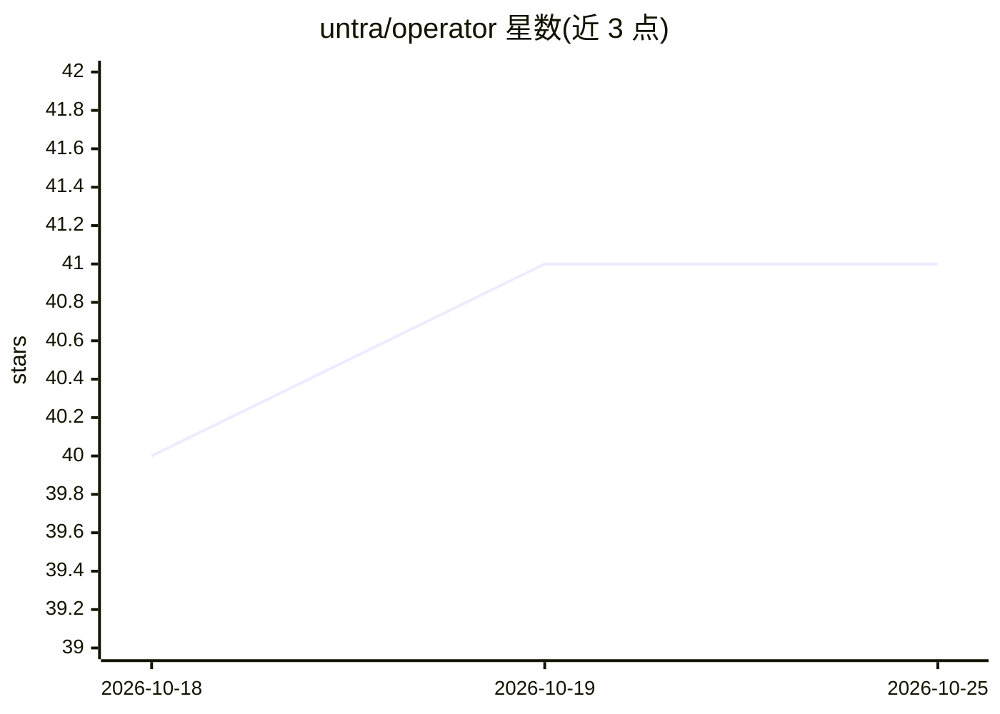

# untra/operator

⭐ 41 · Rust · MIT · 推送 2026-10-22 · [GitHub](https://github.com/untra/operator) · [官网](http://operator.untra.io/) · 个人维护

**管理多 AI 编码 agent 的看板式编排 TUI 工具**

TUI 终端应用，通过 tmux/cmux/Zellij 会话封装，在多仓库工作区内按看板工单启动、监控、暂停/恢复多个 LLM 编码 agent（Claude Code、Codex、Gemini CLI、Grok）。工单按优先级（INV/FIX/FEAT/SPIKE）分配，支持并行 agent 与人工配对模式；可对接 Operator 自带、Jira、Linear、GitHub Projects 看板源，经 CLI 工具调用 LLM，模型服务器支持 ollama 等端点。项目自述处于 ALPHA 阶段，附带独立 Web 管理组件与 REST API。提供各平台二进制下载与源码构建。

## 筛选速览

| 维度 | 判定 | 备注 |
|---|---|---|
| AI 角色 | `ai-ecosystem` | LLM/agent 周边工具 |
| 许可风险 | `permissive` | MIT |
| 部署形态 | `desktop` | 安装包/桌面程序 |
| 模型依赖 | local-ok | 支持本地模型 |
| 硬件要求 | — | 无带数字的原话,不猜 |
| 安装摩擦 | `medium` | 含编译或系统依赖之一 |
| 成熟度 | `idea` | |

## 能力要点

- 按工单优先级启动/监控 LLM 编码 agent，支持并行与暂停恢复
- 支持 Claude Code、Codex、Gemini CLI、Grok 四类 CLI 工具，可按 JSON schema 扩展新工具
- 可声明 ollama、lmstudio、vllm 等 OpenAI 兼容模型服务器作为后端
- 工单来源支持 Operator 自带、Jira Cloud、Linear、GitHub Projects

## 适用场景

- 把看板工单分派给多个 AI 编码 agent 并行开发
- 在多仓库工作区内追踪各 agent 的工单进度与人工审查
- 通过 webhook/CLI 从外部告警触发紧急调查工单

## 场景标签

`编码 Agent` `多智能体` · 领域:Agent 开发

## 证据(README 行号)

> L45: `operator` is a TUI (terminal user interface) application that uses session wrappers (tmux, cmux, or Zellij) to man
> L28: An orchestration tool for **AI-assisted** _kanban-shaped_ git-versioned software development.

## 星数曲线

2026-10-18 40 → 2026-10-25 41（+1）

---
*卡片 v1 · prompt 1.4 · 生成 2026-10-25 · 置信度 high · 依据 README sha `2b7091ba0ac2` · [字段定义](../../DATASET.md)*
