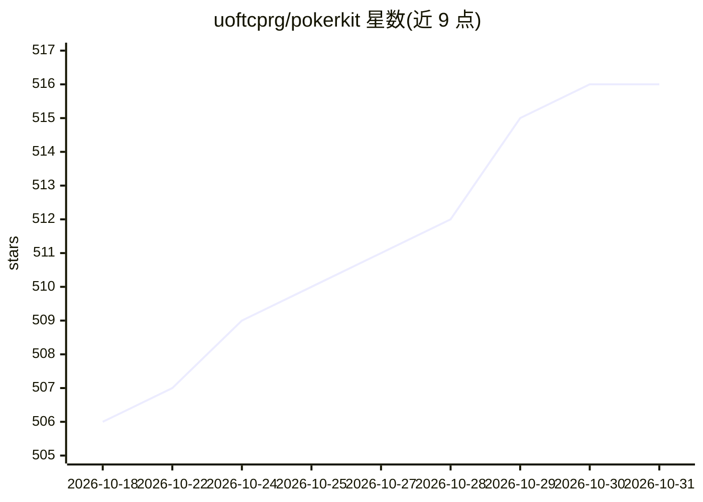

# uoftcprg/pokerkit

⭐ 516 · Python · MIT · 推送 2026-10-12 · [GitHub](https://github.com/uoftcprg/pokerkit) · [官网](https://pokerkit.readthedocs.io/) · 组织维护

**纯 Python 扑克游戏模拟与牌力评估库，供扑克 AI 开发使用**

由计算机扑克研究组开发的纯 Python 库，提供扑克游戏状态模拟、高速牌力评估与统计分析功能，覆盖德州扑克、短牌、奥马哈、2-7三次抽牌、Badugi 等多种变体，并支持用户自定义游戏规则。功能通过统一的高层 API 暴露，可配置下注自动化（前注、盲注、筹码推送等）。README 示例复现了多个真实 televised 牌局。要求 Python 3.11 及以上，经静态类型检查、doctest 与单元测试，代码覆盖率 99%。

## 筛选速览

| 维度 | 判定 | 备注 |
|---|---|---|
| AI 角色 | `ai-ecosystem` | LLM/agent 周边工具 |
| 许可风险 | `permissive` | MIT |
| 部署形态 | `library` | 以包/库形式分发 |
| 模型依赖 | — | README 未给出锁定关系 |
| 硬件要求 | — | 无带数字的原话,不猜 |
| 安装摩擦 | `low` | 无编译、无系统依赖或容器化 |
| 成熟度 | — | 结构信号不足 |

## 能力要点

- 支持多种主流与非主流扑克变体（德州/短牌/奥马哈/2-7 Triple Draw/Badugi 等）
- 可自定义游戏状态与参数，含下注流程自动化配置
- 高速牌力评估
- 静态类型检查与 99% 代码覆盖率（单元测试与 doctest）

## 适用场景

- 扑克 AI 开发的环境模拟与手牌评估
- 构建扑克工具或统计分析程序
- 在线扑克平台的规则引擎实现

## 场景标签

 · 领域:游戏/博弈论（扑克引擎）

## 证据(README 行号)

> L1: PokerKit
> L3: PokerKit is an open-source software library, written in pure Python, for simulating games, evaluating hands, and fac

## 星数曲线

2026-10-18 506 → 2026-10-31 516（+10）

---
*卡片 v1 · prompt 1.4 · 生成 2026-10-21 · 置信度 high · 依据 README sha `c7223ba3b5a4` · [字段定义](../../DATASET.md)*
