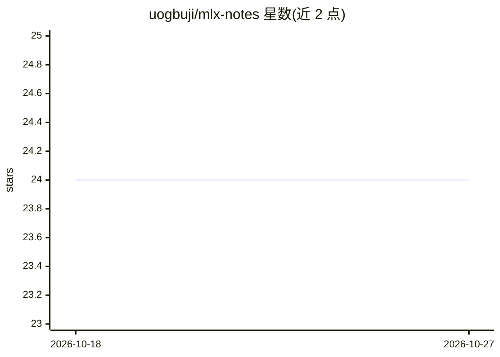

# uogbuji/mlx-notes

⭐ 24 · Jupyter Notebook · CC-BY-4.0 · 推送 2025-12-12 · [GitHub](https://github.com/uogbuji/mlx-notes) · [官网](https://ucheog.carrd.co/) · 个人维护

**Apple MLX 框架的个人学习笔记与文章合集**

个人维护的 MLX 学习笔记仓库，收录多篇关于 Apple MLX 框架的文章（MLX 入门、从 Hugging Face 转换模型、基于 MLX 的检索增强生成两部分等），每篇提供渲染后的 Markdown、LinkedIn 版本与 Jupyter notebook 三种形式，封面图由 Google Gemini 生成。另汇总 MLX 相关外部资源链接（主页、Hugging Face MLX 社区、微调笔记本、MLX Tuning Fork 等），以及关于聊天格式、采样方法、steering vectors 的待研究清单。提供 jupytext 命令将 .md 文章转为 .ipynb 笔记本，采用 CC BY 4.0 许可。

## 筛选速览

| 维度 | 判定 | 备注 |
|---|---|---|
| AI 角色 | `ai-knowledge` | 知识聚合/清单类 |
| 许可风险 | `viral` | CC-BY-4.0 |
| 部署形态 | `None` |  |
| 模型依赖 | — | README 未给出锁定关系 |
| 硬件要求 | — | 无带数字的原话,不猜 |
| 安装摩擦 | `low` | 无编译、无系统依赖或容器化 |
| 成熟度 | — | 结构信号不足 |

## 能力要点

- 多篇 MLX 文章（入门/模型转换/RAG）各带 Markdown、LinkedIn 与 Jupyter notebook 版本
- 汇总 MLX 官方主页、Hugging Face MLX 社区与微调资源链接
- jupytext 一键将 .md 文章转换为 .ipynb 笔记本

## 适用场景

- 入门学习 Apple MLX 框架与 LLM 使用
- 了解 Hugging Face 模型转 MLX 格式与基于 MLX 的 RAG 实现
- 查找 MLX 生态的微调与社区资源

## 场景标签

 · 领域:机器学习/知识分享

## 证据(README 行号)

> L1: # Notes on the Apple MLX machine learning framework
> L3: ## Apple MLX for AI/Large Language Models—Day One
> L35: # More (up to date) MLX resources

## 星数曲线

2026-10-18 24 → 2026-10-27 24（+0）

---
*卡片 v1 · prompt 1.4 · 生成 2026-10-27 · 置信度 high · 依据 README sha `718770429ad9` · [字段定义](../../DATASET.md)*
