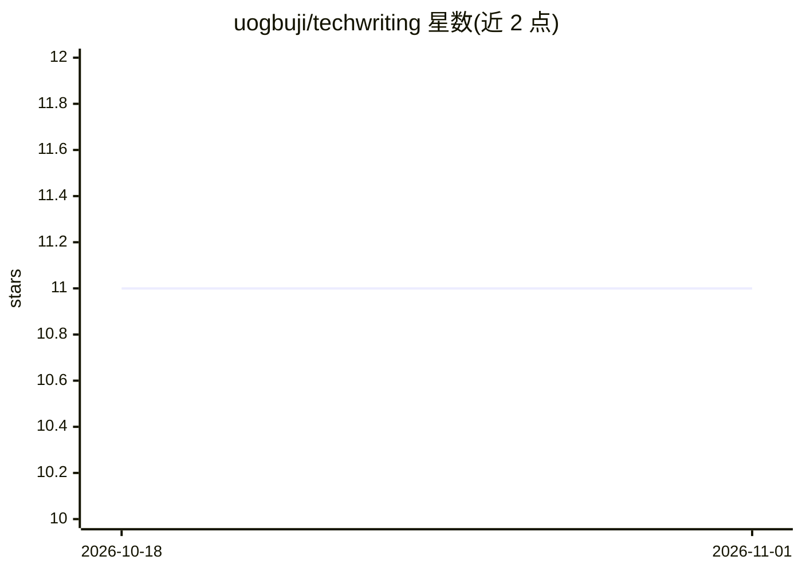

# uogbuji/techwriting

⭐ 11 · Python · Apache-2.0 · 推送 2026-08-12 · [GitHub](https://github.com/uogbuji/techwriting) · [官网](http://uche.ogbuji.net) · 个人维护

**Uche Ogbuji 技术文章与教程的文集仓库**

存放 Uche Ogbuji 撰写的技术文章与教程的仓库，包含文章链接、正文与代码。作者为数据架构与分布式系统领域工程师，曾参与 XML、RDF 与 Web 服务技术的推广，文章发表于 IBM developerWorks、XML.com 等刊物。仓库还附作者简介，涉及其诗歌与音乐创作身份。README 未给出安装或运行说明。

## 筛选速览

| 维度 | 判定 | 备注 |
|---|---|---|
| AI 角色 | `ai-knowledge` | 知识聚合/清单类 |
| 许可风险 | `permissive` | Apache-2.0 |
| 部署形态 | `None` |  |
| 模型依赖 | — | README 未给出锁定关系 |
| 硬件要求 | — | 无带数字的原话,不猜 |
| 安装摩擦 | `low` | 无编译、无系统依赖或容器化 |
| 成熟度 | — | 结构信号不足 |

## 能力要点

- 汇集文章链接、正文与代码
- 主题涵盖 XML、RDF、Web 服务与 Python

## 适用场景

- 查阅 XML/RDF/数据架构相关的技术文章与示例代码
- 了解作者的技术写作产出

## 场景标签

`教程课程` · 领域:学习与行业

## 证据(README 行号)

> L1: # Tech writing
> L3: Article links, article text, code, etc. for Uche Ogbuji's technical articles & tutorials

## 星数曲线

2026-10-18 11 → 2026-11-01 11（+0）

---
*卡片 v1 · prompt 1.4 · 生成 2026-11-01 · 置信度 mid · 依据 README sha `f2b18da9b8e3` · [字段定义](../../DATASET.md)*
