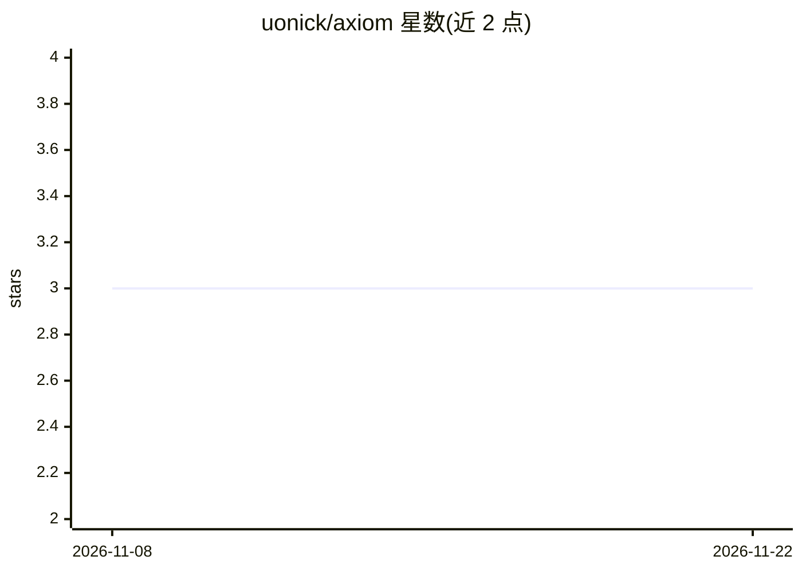

# uonick/axiom

⭐ 3 · Astro · 推送 2026-11-17 · [GitHub](https://github.com/uonick/axiom) · [官网](https://getaxiom.ru) · 个人维护

**面向开发者的本地优先 AI 桌面编程助手应用**

Axiom 是一款桌面端 AI 开发环境应用，将全项目上下文注入聊天：提供 Agent（读写/执行）、Plan、Debug、Ask 四种模式，AI 可浏览代码、应用 diff、运行沙箱命令。深度集成本地文件系统、Git 面板、多会话终端及 npm/Composer/Docker Compose 运行时管理；强调本地优先，代码、聊天记录与凭据留在本机。支持通过 @ 提及注入文件、规则、技能与多步管线，原生支持 MCP 服务器扩展工具。安装包经 GitHub Releases 分发。

## 筛选速览

| 维度 | 判定 | 备注 |
|---|---|---|
| AI 角色 | `ai-native` | 本体是模型或模型工具 |
| 许可风险 | `none` | — |
| 部署形态 | `self-host` | docker 或自建部署 |
| 模型依赖 | local-ok | 支持本地模型 |
| 硬件要求 | — | 无带数字的原话,不猜 |
| 安装摩擦 | `low` | 无编译、无系统依赖或容器化 |
| 成熟度 | — | 结构信号不足 |

## 能力要点

- Agent/Plan/Debug/Ask 四种项目感知模式，支持 diff 应用与沙箱命令执行
- 内置多会话终端、Git 面板（diff/commit/worktrees）与运行时管理
- @ 提及注入文件、历史、规则、技能与多步管线
- 支持云厂商、自定义端点、本地 GGUF 模型与 Ollama 切换

## 适用场景

- 在桌面端让 AI 理解整个代码库后进行代码修改与调试
- 希望代码与凭据保留在本地的本地优先 AI 辅助开发
- 通过 MCP 扩展让 AI 调用外部工具

## 场景标签

`编码 Agent` · 领域:编码与开发

## 证据(README 行号)

> L3: Axiom is an AI-powered desktop application that brings full-project context to your chat. It is designed for develop
> L9: - **Project-Aware AI Modes:** Choose between Agent (read/write/execute), Plan, Debug, and Ask (read-only) modes. The

## 星数曲线

2026-11-08 3 → 2026-11-22 3（+0）

---
*卡片 v1 · prompt 1.4 · 生成 2026-11-21 · 置信度 mid · 依据 README sha `3871222a4a9d` · [字段定义](../../DATASET.md)*
