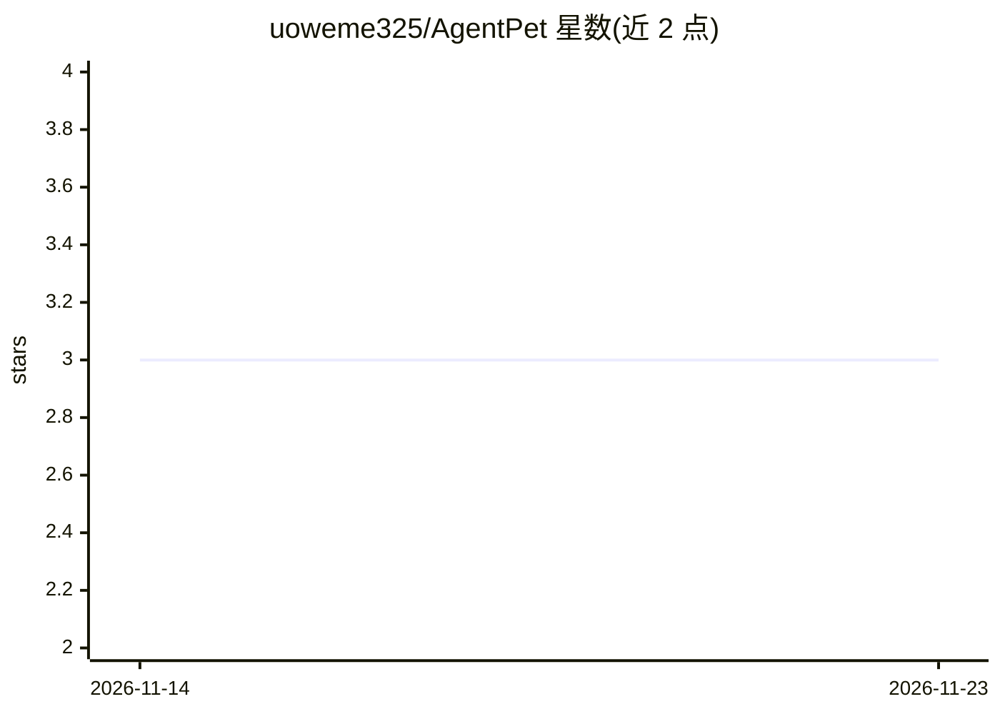

# uoweme325/AgentPet

⭐ 3 · JavaScript · MIT · 推送 2026-11-18 · [GitHub](https://github.com/uoweme325/AgentPet) · [官网](https://uoweme325.github.io/) · 个人维护 · 中文 README

**Windows 桌宠，实时联动显示 AI Agent 状态与额度余额**

基于 PowerShell 和 WPF 的 Windows 桌面宠物，支持联动 Antigravity、Codex 和 DeepSeek Harness（DSH）三类 Agent：通过气泡展示思考、工作、等待确认等状态，并提供 Codex 额度票夹与 DeepSeek 人民币余额看板（余额由本机 DSH 宿主鉴权查询，程序不读取登录凭据）。提供五款角色立绘、系统托盘、屏幕边界保护与阈值提醒。以发布页 zip 免安装便携方式分发，状态监控需要 Node.js 运行时，余额功能需要本机运行 DSH。

## 筛选速览

| 维度 | 判定 | 备注 |
|---|---|---|
| AI 角色 | `ai-enhanced` | 去掉 AI 部分产品仍成立 |
| 许可风险 | `permissive` | MIT |
| 部署形态 | `None` |  |
| 模型依赖 | — | README 未给出锁定关系 |
| 硬件要求 | — | 无带数字的原话,不猜 |
| 安装摩擦 | `low` | 无编译、无系统依赖或容器化 |
| 成熟度 | — | 结构信号不足 |

## 能力要点

- 联动 Antigravity、Codex、DeepSeek Harness 的工作状态气泡展示
- Codex 五小时/每周额度票夹与额度偏低告警
- 通过本机 DSH 宿主查询 DeepSeek 人民币余额与充值/赠金明细
- 五角色立绘、系统托盘、拖动边界与位置复位

## 适用场景

- 等待 AI Agent 编码任务时在桌面查看其思考/工作/等待确认状态
- 监控 Codex 订阅额度的剩余量与重置时间
- 查看 DeepSeek 账户人民币余额并在低于阈值时收到提醒

## 场景标签

 · 领域:桌面工具/开发者工具

## 证据(README 行号)

> L3: 把 Agent 的工作状态带到桌面上，让等待 Agent 工作的时间少一些无聊。
> L5: AgentPet 是一款 Windows 桌宠，支持联动 **Antigravity（反重力）、Codex 和 DeepSeek Harness（DSH）**。它会通过气泡展示思考、工作和等待确认等状态，也能帮你查看 Codex 额
> L27: - **免安装便携**：解压后即可启动，无需安装桌宠程序。Agent 状态监控需要 Node.js，DeepSeek 余额功能需要本机 DSH。
> L44: - 桌宠运行于 Windows，基于 PowerShell 和 WPF。

## 星数曲线

2026-11-14 3 → 2026-11-23 3（+0）

---
*卡片 v1 · prompt 1.4 · 生成 2026-11-21 · 置信度 high · 依据 README sha `e3781ac52b73` · [字段定义](../../DATASET.md)*
