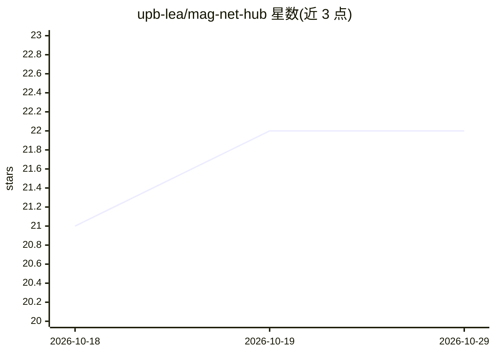

# upb-lea/mag-net-hub

⭐ 22 · Python · MIT · 推送 2026-10-25 · [GitHub](https://github.com/upb-lea/mag-net-hub) · 组织维护

**磁性元件认证模型工具包：预测功率损耗与 H 波形**

统一接口托管 MagNet Challenge 2023/2025 的认证模型，面向电力电子变换器设计场景：损耗模型接收周期性 B 波形、频率、温度与材料，输出标量功率损耗估计（及可选 H 波形）；序列到序列模型根据过去 B/H 样本预热窗口、未来 B 序列与温度预测未来 H 序列，可处理变长波形。模型以带预训练系数的可执行代码提供，不做训练。限制：仅支持稳态、无变化直流偏置，训练数据来自固定尺寸环形铁氧体，序列模型固定 16 MHz 采样率且超出训练范围会告警。以 Python 包形式提供，推荐 Python 3.13。

## 筛选速览

| 维度 | 判定 | 备注 |
|---|---|---|
| AI 角色 | `ai-native` | 本体是模型或模型工具 |
| 许可风险 | `permissive` | MIT |
| 部署形态 | `library` | 以包/库形式分发 |
| 模型依赖 | — | README 未给出锁定关系 |
| 硬件要求 | — | 无带数字的原话,不猜 |
| 安装摩擦 | `low` | 无编译、无系统依赖或容器化 |
| 成熟度 | — | 结构信号不足 |

## 能力要点

- 损耗模型：输入周期 B 波形/频率/温度/材料，输出功率损耗估计与可选 H 波形
- 序列到序列模型：从 B/H 预热窗口预测未来 H 波形，支持变长输入
- 模型自带预训练系数，无需训练即可推理
- 覆盖 3C90/N87/N49 等十余种铁氧体材料

## 适用场景

- 功率变换器设计中估算磁性元件损耗，作为数据手册的补充
- 根据 B 波形预测 H 波形用于磁件特性分析
- 复现或使用 MagNet Challenge 的认证模型结果

## 场景标签

 · 领域:电力电子/磁件建模

## 证据(README 行号)

> L6: This repository provides a unified interface for certified magnetic component models from both the MagNet Challenge 
> L9: - **Loss models** accept a periodic $B$ waveform, frequency, temperature, and material to produce a scalar power los
> L10: - **Sequence-to-sequence models** predict a future $H$ sequence directly from a short warmup window of past $B$ / $

## 星数曲线

2026-10-18 21 → 2026-10-29 22（+1）

---
*卡片 v1 · prompt 1.4 · 生成 2026-10-27 · 置信度 high · 依据 README sha `344c5c4a4f67` · [字段定义](../../DATASET.md)*
