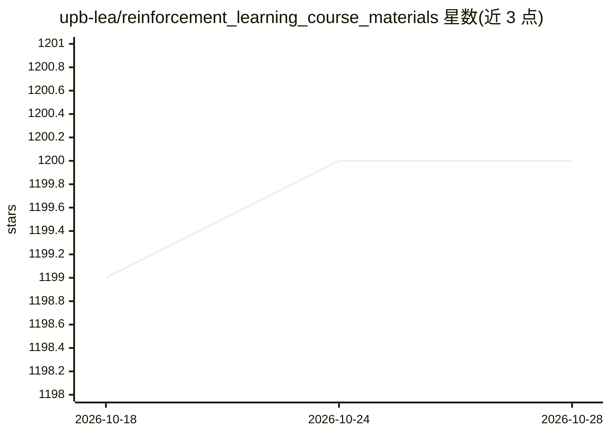

# upb-lea/reinforcement_learning_course_materials

⭐ 1,200 · Jupyter Notebook · NOASSERTION · 推送 2026-01-05 · [GitHub](https://github.com/upb-lea/reinforcement_learning_course_materials) · 组织维护

**帕德博恩大学强化学习课程讲义与习题集（含视频）**

帕德博恩大学发起、现转至锡根大学的强化学习课程开源材料：涵盖马尔可夫决策过程、动态规划、蒙特卡洛、时序差分、函数逼近、策略梯度、PPO/DDPG 等 15 个主题的讲义幻灯片与授课视频，以及 12 组带视频讲解、模板与解答的 Jupyter 习题（Python 3.12，pip 安装依赖）。面向自学的学生与开设课程的高校教师，采用 CC BY 4.0 许可，习题部分使用 Gymnasium 环境。

## 筛选速览

| 维度 | 判定 | 备注 |
|---|---|---|
| AI 角色 | `ai-knowledge` | 知识聚合/清单类 |
| 许可风险 | `none` | NOASSERTION |
| 部署形态 | `library` | 以包/库形式分发 |
| 模型依赖 | — | README 未给出锁定关系 |
| 硬件要求 | — | 无带数字的原话,不猜 |
| 安装摩擦 | `low` | 无编译、无系统依赖或容器化 |
| 成熟度 | — | 结构信号不足 |

## 能力要点

- 15 个强化学习主题的讲义、视频与总结幻灯片
- 12 组习题，每题含教学视频、模板与解答
- CC BY 4.0 许可，可自用学习或搭建课程
- 基于 Python 3.12 与 Gymnasium 环境

## 适用场景

- 系统自学强化学习，从表格方法到深度策略梯度
- 高校教师复用材料开设自己的强化学习课程
- 通过带解答的编程习题动手练习 RL 算法

## 场景标签

`教程课程` `强化学习` · 领域:学习与行业

## 证据(README 行号)

> L13: Lecture notes, tutorial tasks including solutions as well as online videos for a reinforcement learning course orig
> L67: All exercises are based on Python 3.12 and site-packages according to the requirements.txt:

## 星数曲线

2026-10-18 1,199 → 2026-10-28 1,200（+1）

---
*卡片 v1 · prompt 1.4 · 生成 2026-10-21 · 置信度 mid · 依据 README sha `7e77d77a8ceb` · [字段定义](../../DATASET.md)*
