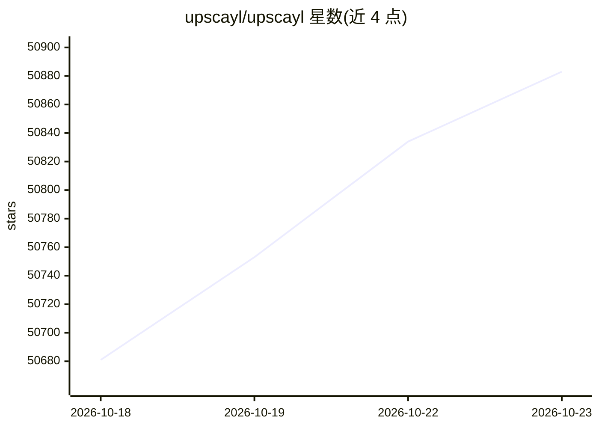

# upscayl/upscayl

⭐ 50,883 · TypeScript · AGPL-3.0 · 推送 2026-10-05 · [GitHub](https://github.com/upscayl/upscayl) · [官网](https://upscayl.org) · 组织维护

**面向普通用户的免费开源 AI 图像放大与增强桌面应用**

基于 Real-ESRGAN 模型与 Vulkan 架构的图像放大工具，将低分辨率图像放大并增强细节，后端以 AGPLv3 开源。提供 Linux（Flatpak/AppImage/AUR/Snap/RPM/DEB）、macOS（dmg/App Store/Homebrew）、Windows（exe）安装包，附带 CLI 工具 upscayl-ncnn 与自定义模型仓库。限制：需要 Vulkan 兼容 GPU，多数集成显卡与 CPU 不可用；不支持去模糊或对焦调整。

## 筛选速览

| 维度 | 判定 | 备注 |
|---|---|---|
| AI 角色 | `ai-enhanced` | 去掉 AI 部分产品仍成立 |
| 许可风险 | `viral` | AGPL-3.0 |
| 部署形态 | `desktop` | 安装包/桌面程序 |
| 模型依赖 | — | README 未给出锁定关系 |
| 硬件要求 | — | 无带数字的原话,不猜 |
| 安装摩擦 | `low` | 无编译、无系统依赖或容器化 |
| 成熟度 | — | 结构信号不足 |

## 动量与使用信号

- 维护:`active` — 距上次 push 12.5 天,年发版 0,46 位贡献者
- 涨星:近 1 天 **+56**(自 20261016 起算)
- 平台:WINDOWS / MACOS / LINUX · 协议:—

## 能力要点

- 使用 Real-ESRGAN 模型放大低分辨率图像，后端 AGPLv3 开源
- 提供批量处理，可加载 custom-models 仓库的更多模型
- 附带 CLI 工具 upscayl-ncnn
- 三平台桌面安装包覆盖 Linux/macOS/Windows

## 适用场景

- 把低分辨率老照片放大到可打印的尺寸
- 批量处理一批像素化截图并保持画质
- 在无网络环境下用本地模型增强图片

## 场景标签

`图像视频处理` · 领域:感知与多模态

## 证据(README 行号)

> L45: #### Free and Open Source AI Image Upscaler
> L46: Upscayl lets you enlarge and enhance low-resolution images using advanced AI algorithms.
> L167:  - Upscayl uses AI models to enhance your images by guessing what the details could be. It uses Real-ESRGAN and Vu

## 星数曲线

2026-10-18 50,681 → 2026-10-23 50,883（+202）

---
*卡片 v1 · prompt 1.4 · 生成 2026-10-18 · 置信度 high · 依据 README sha `e2b6e29916bf` · [字段定义](../../DATASET.md)*
