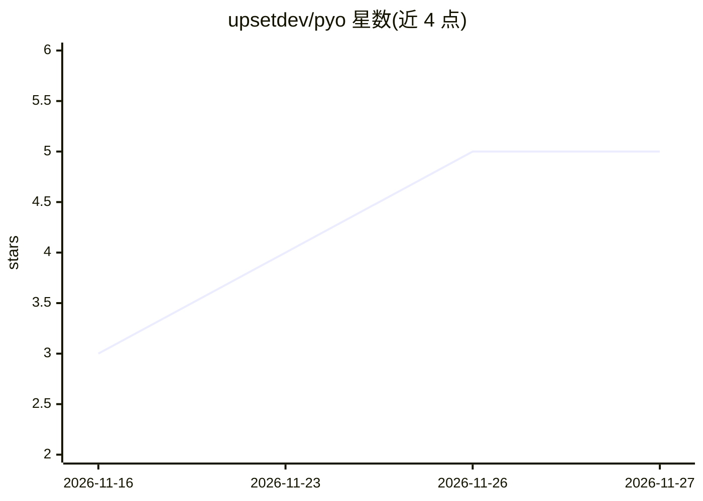

# upsetdev/pyo

⭐ 5 · Rust · Apache-2.0 · 推送 2026-11-26 · [GitHub](https://github.com/upsetdev/pyo) · [官网](https://pyo.dev) · 组织维护

**自托管开源 PaaS：在自己服务器上部署应用与服务**

Pyo 是一个可部署在自己硬件（VPS、独立服务器或本地机器）上的开源 PaaS：选择 Git 仓库、镜像或模板即可构建、运行并通过 HTTPS 发布。底层运行 k3s（轻量 Kubernetes 发行版），提供数据库托管（Postgres/MySQL/KV）、Firecracker/gVisor 隔离沙箱、卷备份恢复、自动 HTTPS、滚动更新与自愈。支持单机起步扩展到集群，通过 dashboard、CLI、API 或 MCP 操作，卸载脚本保留卷数据。

## 筛选速览

| 维度 | 判定 | 备注 |
|---|---|---|
| AI 角色 | `ai-enhanced` | 去掉 AI 部分产品仍成立 |
| 许可风险 | `permissive` | Apache-2.0 |
| 部署形态 | `self-host` | docker 或自建部署 |
| 模型依赖 | — | README 未给出锁定关系 |
| 硬件要求 | — | 无带数字的原话,不猜 |
| 安装摩擦 | `low` | 无编译、无系统依赖或容器化 |
| 成熟度 | — | 结构信号不足 |

## 能力要点

- 基于 k3s 运行，部署产物为标准 Kubernetes 资源
- Firecracker microVM / gVisor 隔离沙箱，供 AI agents、代码解释器与 CI 使用
- 数据库托管：Postgres、MySQL、KV，含故障转移与时点恢复备份
- GitHub 推送自动部署、一键回滚、自动 Let's Encrypt 证书

## 适用场景

- 在自己的 VPS 或家用服务器上搭建应用托管平台
- 为 AI agent 或代码解释器提供隔离沙箱环境
- 团队从单机起步，随规模增长扩展到多服务器集群
- 托管需要自动备份与故障转移的 Postgres/MySQL 数据库

## 场景标签

 · 领域:云计算/部署平台

## 证据(README 行号)

> L5: **The open-source PaaS alternative to Vercel, Netlify, Railway, Render and Fly.io.**
> L32: - **Sandboxes:** isolated machines for AI agents, code interpreters, previews
> L53: - **Work your way:** the dashboard, the `pyo` CLI, an API, or MCP for AI

## 星数曲线

2026-11-16 3 → 2026-11-27 5（+2）

---
*卡片 v1 · prompt 1.4 · 生成 2026-11-21 · 置信度 mid · 依据 README sha `df2d4a53c35a` · [字段定义](../../DATASET.md)*
