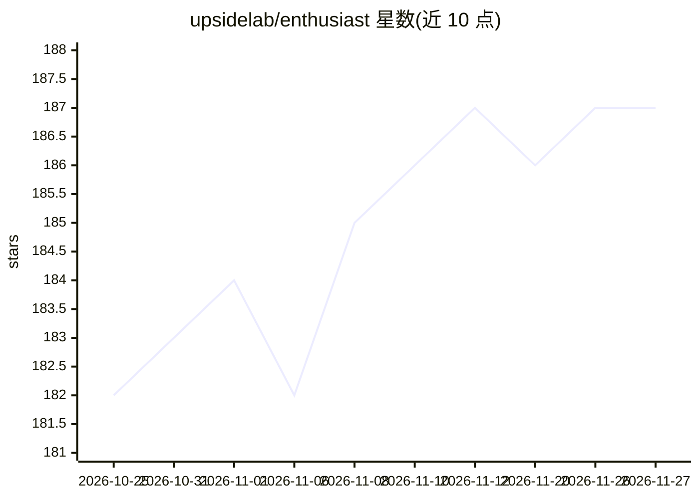

# upsidelab/enthusiast

⭐ 187 · Python · MIT · 推送 2026-11-18 · [GitHub](https://github.com/upsidelab/enthusiast) · [官网](https://upsidelab.io/tools/enthusiast) · 组织维护

**电商领域定义包：为 Suvereo 框架提供电商数据、连接器与 Agent**

Enthusiast 是 Suvereo agentic AI 框架的电商领域定义，以一组 Python 包形式安装到 Suvereo 部署中。Suvereo 提供对话、agentic 执行、语言模型、用户权限与后台 UI；Enthusiast 补充电商专属部分：面向语义搜索的产品与文档索引、电商店铺连接器（Shopify、Shopware、Solidus、WooCommerce、WordPress、Sanity 等），以及产品搜索、订单录入、目录增强等预构建 Agent。独立的 1.7 版本已被以插件包形态集成进 Suvereo 的架构取代，另有 1.7 文档与 v1.7.1 发布。

## 筛选速览

| 维度 | 判定 | 备注 |
|---|---|---|
| AI 角色 | `ai-native` | 本体是模型或模型工具 |
| 许可风险 | `permissive` | MIT |
| 部署形态 | `library` | 以包/库形式分发 |
| 模型依赖 | — | README 未给出锁定关系 |
| 硬件要求 | — | 无带数字的原话,不猜 |
| 安装摩擦 | `low` | 无编译、无系统依赖或容器化 |
| 成熟度 | — | 结构信号不足 |

## 能力要点

- 以多个 PyPI 包形式安装到 Suvereo 部署
- 预构建集成覆盖 Shopify、Shopware、Solidus、WooCommerce、WordPress、Sanity、Medusa
- 内置产品搜索、订单录入、目录增强等预构建 Agent
- 产品与文档数据索引支持语义搜索

## 适用场景

- 让用户用自然语言在商品目录中搜索产品
- 把扫描的采购单或笔记等非结构化输入转成电商订单
- 从供应商网页直接导入产品数据
- 从供应商发票提取行项目并更新库存

## 场景标签

`RAG` `语义搜索` · 领域:知识与检索

## 证据(README 行号)

> L7:  The e-commerce domain definition for the Suvereo agentic AI framework.
> L14: Enthusiast is the open-source e-commerce domain definition for Suvereo, an agentic AI framework.
> L16: Suvereo provides the platform: conversations, agentic executions, language models, users and permissions, and the a

## 星数曲线

2026-10-25 182 → 2026-11-27 187（+5）

---
*卡片 v1 · prompt 1.4 · 生成 2026-11-26 · 置信度 high · 依据 README sha `b1d70cd96a0a` · [字段定义](../../DATASET.md)*
