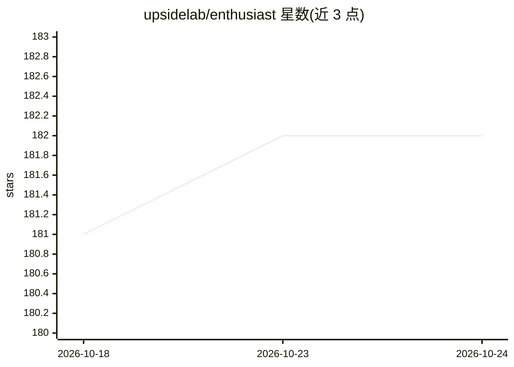

# upsidelab/enthusiast

⭐ 182 · Python · MIT · 推送 2026-06-23 · [GitHub](https://github.com/upsidelab/enthusiast) · [官网](https://upsidelab.io/tools/enthusiast) · 组织维护

**面向电商的开源 Agentic AI 工作流构建框架**

Enthusiast 是一个用于构建电商场景 AI agentic 工作流的开源工具包，提供 RAG、向量搜索与工作流编排组件，并含验证与评估组件以减少幻觉、保证回答有据可依。可接入 OpenAI 等云端模型，或 Mistral、LLaMA、Deepseek 的自托管部署。技术栈为 Python/Django/PostgreSQL/React，预置与主流电商平台的集成。示例用例包括自然语言商品搜索、手册问答、订单录入与商品目录富化。采用 MIT 许可证。

## 筛选速览

| 维度 | 判定 | 备注 |
|---|---|---|
| AI 角色 | `ai-ecosystem` | LLM/agent 周边工具 |
| 许可风险 | `permissive` | MIT |
| 部署形态 | `None` |  |
| 模型依赖 | — | README 未给出锁定关系 |
| 硬件要求 | — | 无带数字的原话,不猜 |
| 安装摩擦 | `low` | 无编译、无系统依赖或容器化 |
| 成熟度 | — | 结构信号不足 |

## 能力要点

- 提供 RAG、向量搜索与工作流编排工具
- 兼容 OpenAI 与 Mistral/LLaMA/Deepseek 自托管部署
- 预置电商平台集成，标准 Python/Django/PostgreSQL/React 栈
- 含验证与评估组件，用于减少幻觉

## 适用场景

- 为电商搭建自然语言商品搜索
- 基于产品手册和技术文档构建问答
- 将扫描订单等非结构化输入转为电商订单
- 从商品资料中抽取描述、属性或翻译以富化目录

## 场景标签

 · 领域:电商/AI 应用框架

## 证据(README 行号)

> L14: Enthusiast is an open-source toolkit for building AI-powered agentic workflows. It provides tools like Retrieval-Ag
> L16: Enthusiast helps you cut down time, cost and complexity when building AI-powered tools with customized agents - for

## 星数曲线

2026-10-18 181 → 2026-10-24 182（+1）

---
*卡片 v1 · prompt 1.4 · 生成 2026-10-22 · 置信度 high · 依据 README sha `23aad7efdc1f` · [字段定义](../../DATASET.md)*
