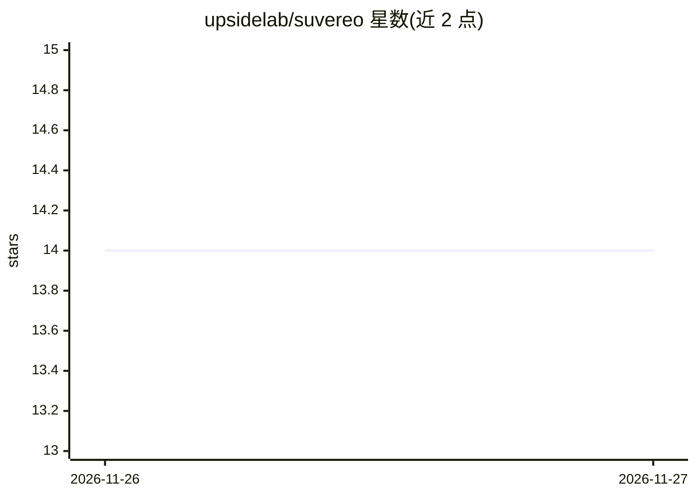

# upsidelab/suvereo

⭐ 14 · Python · MIT · 推送 2026-11-26 · [GitHub](https://github.com/upsidelab/suvereo) · [官网](https://upsidelab.io/suvereo) · 组织维护

**在自有基础设施上运行 AI agent 的开源框架**

Suvereo 是一个用于在企业自有系统上运行 AI agent 的框架：通过数据集划分作用域，支持 Web UI/API 对话（流式输出与历史保存）、API 触发的自主执行（带结构化输入输出与校验器回环）、RAG 语义检索、外部系统集成（含 MCP 服务器）、评测套件与 CI 回归检测、角色与分组访问控制。采用插件化架构，基于 Python、Django、PostgreSQL/pgvector 与 React 技术栈，通过 Docker Compose 运行，领域无关，支持自定义领域定义。

## 筛选速览

| 维度 | 判定 | 备注 |
|---|---|---|
| AI 角色 | `ai-ecosystem` | LLM/agent 周边工具 |
| 许可风险 | `permissive` | MIT |
| 部署形态 | `self-host` | docker 或自建部署 |
| 模型依赖 | local-ok | 支持本地模型 |
| 硬件要求 | — | 无带数字的原话,不猜 |
| 安装摩擦 | `low` | 无编译、无系统依赖或容器化 |
| 成熟度 | — | 结构信号不足 |

## 能力要点

- 对话与自主 agent 执行，校验器可让 agent 修正答案
- 内容切分嵌入的 RAG 语义搜索，agent 基于自有数据回答
- 插件架构：模型、集成、agent 与领域定义均为可安装包
- 多模型选择：OpenAI、Azure OpenAI、Anthropic、Gemini、Mistral、Ollama

## 适用场景

- 在自有基础设施上部署管理面向团队的 agent 助手
- 基于企业自有文档与业务系统构建 RAG 问答 agent
- 在 CI 中对 agent 做多模型/多提示词评测与回归检测
- 为电商、医疗、法务等定制领域定义接入 agent

## 场景标签

`Agent 框架` `RAG` `模型评测` `聊天机器人` · 领域:Agent 开发

## 证据(README 行号)

> L7:  Production Ready Agentic AI Framework.
> L15: Suvereo is an open-source framework for putting AI agents to work on your own systems. It gives agents access to yo
> L29: - **A standard stack** - Python, Django, PostgreSQL with pgvector, and React, with Docker Compose for development a

## 星数曲线

2026-11-26 14 → 2026-11-27 14（+0）

---
*卡片 v1 · prompt 1.4 · 生成 2026-11-26 · 置信度 high · 依据 README sha `266c622fbdc9` · [字段定义](../../DATASET.md)*
