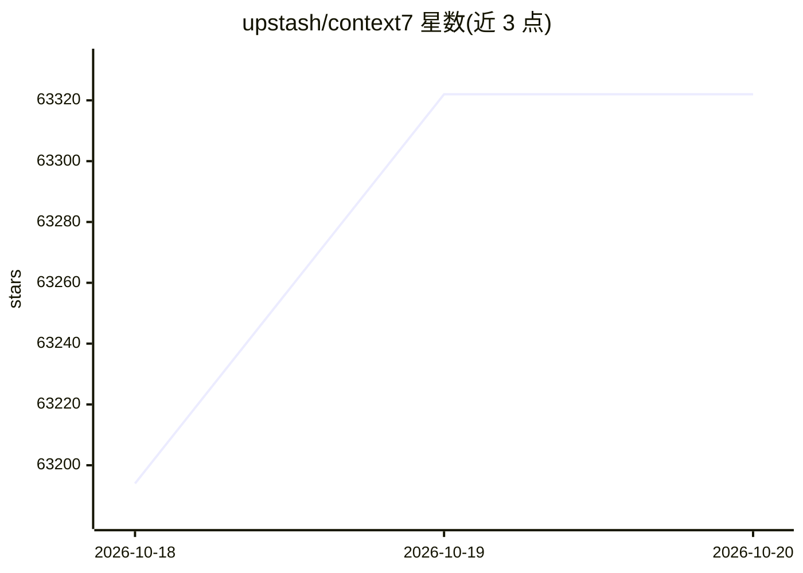

# upstash/context7

⭐ 63,322 · TypeScript · MIT · 推送 2026-10-19 · [GitHub](https://github.com/upstash/context7) · [官网](https://context7.com) · 组织维护 · 中文 README

**为 AI 编码代理提供最新版本库文档的检索平台**

Context7 是 Upstash 维护的文档检索平台，向编码代理注入最新的、特定版本的库文档与代码示例，缓解模型训练数据过时导致的问题。提供两种模式：CLI + Skills（通过 ctx7 命令抓取文档，无需 MCP）与注册 MCP 服务器让代理原生调用文档工具。一条命令完成安装与 OAuth 认证，可用 --cursor/--claude/--opencode 定向配置；支持库 ID 精确匹配与版本指定。注意：API 后端与爬虫引擎为闭源，不在本仓库。

## 筛选速览

| 维度 | 判定 | 备注 |
|---|---|---|
| AI 角色 | `ai-ecosystem` | LLM/agent 周边工具 |
| 许可风险 | `permissive` | MIT |
| 部署形态 | `library` | 以包/库形式分发 |
| 模型依赖 | — | README 未给出锁定关系 |
| 硬件要求 | — | 无带数字的原话,不猜 |
| 安装摩擦 | `low` | 无编译、无系统依赖或容器化 |
| 成熟度 | — | 结构信号不足 |

## 动量与使用信号

- 维护:`active` — 距上次 push 0.7 天,年发版 100,135 位贡献者
- 涨星:近 1 天 **+75**(自 20261016 起算)
- 安装:npm 包 `ctx7` 月下载 172,502
- 平台:— · 协议:MCP

## 能力要点

- CLI + Skills 与 MCP 两种接入模式，一条命令完成设置
- 按库 ID 与版本精确检索文档（/mongodb/docs、/vercel/next.js 等）
- MCP 客户端手动配置支持 30+ 客户端
- 提供 MCP server、CLI、TypeScript SDK、Vercel AI SDK 工具等多个包

## 适用场景

- 让编码代理生成基于最新版本文档的代码示例
- 减少 LLM 幻觉出不存在的 API
- 为多个 AI 编码客户端统一配置文档检索能力

## 场景标签

 · 领域:LLM 基础设施/开发工具

## 证据(README 行号)

> L21: Context7 pulls up-to-date, version-specific documentation and code examples straight from the source — and gives th
> L41: - **CLI + Skills** — installs a skill that guides your agent to fetch docs using `ctx7` CLI commands (no MCP requir
> L42: - **MCP** — registers a Context7 MCP server so your agent can call documentation tools natively

## 星数曲线

2026-10-18 63,194 → 2026-10-20 63,322（+128）

---
*卡片 v1 · prompt 1.4 · 生成 2026-10-18 · 置信度 high · 依据 README sha `ec0aad1d51ea` · [字段定义](../../DATASET.md)*
