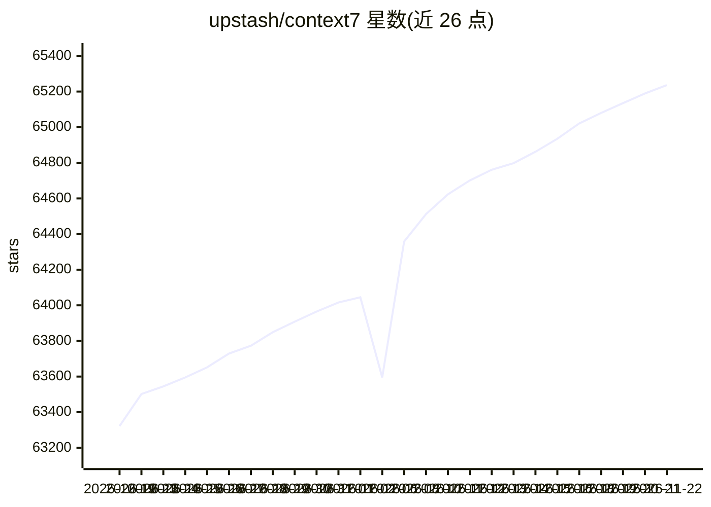

# upstash/context7

⭐ 65,236 · TypeScript · MIT · 推送 2026-11-20 · [GitHub](https://github.com/upstash/context7) · [官网](https://context7.com) · 组织维护 · 中文 README

**为 AI 编码代理提供最新版本库文档的 MCP 服务**

Context7 从源头拉取特定版本的最新文档与代码示例，注入到用户的编码代理上下文中，减少因训练数据过时导致的旧版示例与幻觉 API。支持两种模式：CLI+Skills（通过 ctx7 命令拉取文档，无需 MCP）与 MCP 服务器模式（resolve-library-id、query-docs 两个工具）。npx ctx7 setup 一条命令完成 OAuth 认证、API key 生成与 skill 安装，可用参数指定 Cursor、Claude 等客户端。本仓库只托管 MCP 服务器源码，API 后端与抓取引擎为私有组件，社区贡献文档的准确性不作保证。

## 筛选速览

| 维度 | 判定 | 备注 |
|---|---|---|
| AI 角色 | `ai-ecosystem` | LLM/agent 周边工具 |
| 许可风险 | `permissive` | MIT |
| 部署形态 | `library` | 以包/库形式分发 |
| 模型依赖 | — | README 未给出锁定关系 |
| 硬件要求 | — | 无带数字的原话,不猜 |
| 安装摩擦 | `low` | 无编译、无系统依赖或容器化 |
| 成熟度 | — | 结构信号不足 |

## 动量与使用信号

- 维护:`active` — 距上次 push 0.7 天,年发版 100,135 位贡献者
- 涨星:近 1 天 **+75**(自 20261016 起算)
- 安装:npm 包 `ctx7` 月下载 172,502
- 平台:— · 协议:MCP

## 能力要点

- CLI+Skills 与 MCP 服务器两种接入模式
- resolve-library-id 与 query-docs MCP 工具，支持库 ID 与版本精确匹配
- npx ctx7 setup 一键配置，支持 --cursor/--claude/--opencode 指定客户端
- 提供 MCP 服务器、CLI、TypeScript SDK、Vercel AI SDK 工具等多个包

## 适用场景

- 编码时让代理直接读取所用库的最新版文档
- 避免生成已废弃 API 或过时版本的代码示例
- 在 Cursor/Claude Code 等客户端中配置文档检索规则

## 场景标签

`RAG` · 领域:知识与检索

## 证据(README 行号)

> L21: Context7 pulls up-to-date, version-specific documentation and code examples straight from the source — and gives th
> L41: - **CLI + Skills** — installs a skill that guides your agent to fetch docs using `ctx7` CLI commands (no MCP requir
> L42: - **MCP** — registers a Context7 MCP server so your agent can call documentation tools natively

## 星数曲线

2026-10-19 63,322 → 2026-11-22 65,236（+1,914）

---
*卡片 v1 · prompt 1.4 · 生成 2026-11-22 · 置信度 high · 依据 README sha `000da52bcc0d` · [字段定义](../../DATASET.md)*
