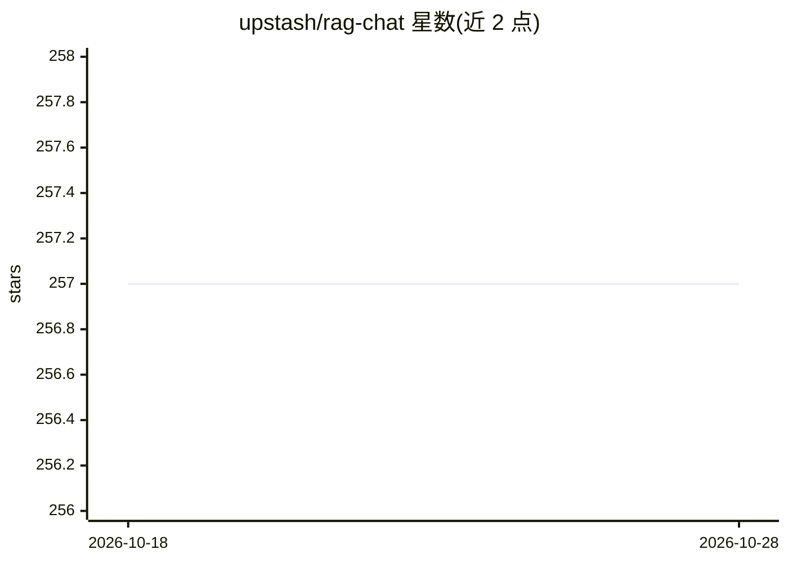

# upstash/rag-chat

⭐ 257 · TypeScript · MIT · 推送 2025-12-15 · [GitHub](https://github.com/upstash/rag-chat) · 组织维护

**面向开发者的 RAG 聊天应用原型开发 SDK**

Upstash 社区维护的 TypeScript SDK（@upstash/rag-chat），用于以少量配置快速开发 RAG 聊天应用：内置向量存储作为知识库，支持摄取整个网站、PDF 等内容，兼容 Next.js 流式输出；可选集成 Redis 聊天历史、速率限制、通过 Helicone/Langsmith/Cloudflare AI Gateway 的分析，以及 disableRag 选项作为纯 LLM 聊天使用。README 中团队自述本项目定位为原型开发，正式项目建议使用 Vercel AI SDK、Langchain、LlamaIndex。提供 npm 安装与多框架快速入门文档。

## 筛选速览

| 维度 | 判定 | 备注 |
|---|---|---|
| AI 角色 | `ai-ecosystem` | LLM/agent 周边工具 |
| 许可风险 | `permissive` | MIT |
| 部署形态 | `library` | 以包/库形式分发 |
| 模型依赖 | — | README 未给出锁定关系 |
| 硬件要求 | — | 无带数字的原话,不猜 |
| 安装摩擦 | `low` | 无编译、无系统依赖或容器化 |
| 成熟度 | `idea` | |

## 能力要点

- 内置向量存储知识库，开箱即用摄取网站与 PDF
- Next.js 兼容与流式输出支持
- 可选 Redis 聊天历史、速率限制与多平台分析
- 支持 OpenAI/Anthropic/GROQ/Ollama/Mistral 等多种模型集成

## 适用场景

- 快速搭建 RAG 原型聊天应用验证想法
- 在 Next.js / Node.js / Cloudflare Workers 等环境接入 RAG 对话
- 用 disableRag 模式做纯 LLM + 历史的聊天应用

## 场景标签

`RAG` · 领域:知识与检索

## 证据(README 行号)

> L13: The `@upstash/rag-chat` package makes it easy to develop retrieval-augmented generation (RAG) chat applications wit
> L6: > The RAG Chat SDK is designed to facilitate easier and faster prototype creation. For real projects, use Vercel AI 

## 星数曲线

2026-10-18 257 → 2026-10-28 257（+0）

---
*卡片 v1 · prompt 1.4 · 生成 2026-10-22 · 置信度 high · 依据 README sha `cda81bded964` · [字段定义](../../DATASET.md)*
