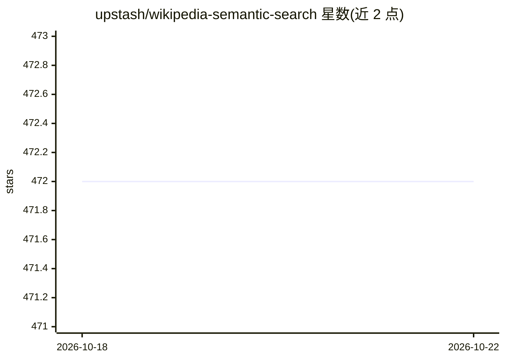

# upstash/wikipedia-semantic-search

⭐ 472 · TypeScript · MIT · 推送 2025-12-12 · [GitHub](https://github.com/upstash/wikipedia-semantic-search) · [官网](https://wikipedia-semantic-search.vercel.app/) · 组织维护

**用 Upstash Vector 索引维基百科的语义搜索与 RAG 聊天示例项目**

Upstash 团队的演示工程：将 1.44 亿条来自 11 种语言维基百科文章的向量（BGE-M3 嵌入）索引到 Upstash Vector，实现跨语言语义搜索，并用 Upstash RAG Chat SDK 搭建 RAG 聊天机器人（LLM 为 Meta-Llama-3-8B-Instruct，经 QStash LLM APIs 调用），聊天会话存于 Upstash Redis。面向希望了解 Upstash Vector 与 RAG Chat SDK 用法的开发者，需在 Upstash 控制台创建 Vector/Redis 数据库并配置凭据，按命名空间分语言灌入向量，pnpm 安装依赖后本地运行。

## 筛选速览

| 维度 | 判定 | 备注 |
|---|---|---|
| AI 角色 | `ai-native` | 本体是模型或模型工具 |
| 许可风险 | `permissive` | MIT |
| 部署形态 | `library` | 以包/库形式分发 |
| 模型依赖 | — | README 未给出锁定关系 |
| 硬件要求 | — | 无带数字的原话,不猜 |
| 安装摩擦 | `low` | 无编译、无系统依赖或容器化 |
| 成熟度 | — | 结构信号不足 |

## 能力要点

- 1.44 亿向量索引，覆盖 11 种语言维基百科
- BGE-M3 嵌入模型实现跨语言语义搜索
- 基于 Upstash RAG Chat SDK 的 RAG 聊天机器人
- 按命名空间（如 en）分语言存储向量

## 适用场景

- 参考该项目搭建基于维基百科的语义搜索
- 学习 Upstash Vector 与 RAG Chat SDK 的接入方式
- 体验跨语言维基百科问答聊天机器人

## 场景标签

 · 领域:搜索/向量检索应用

## 证据(README 行号)

> L7: We've created a semantic search engine and Upstash RAG Chat SDK using Wikipedia data to demonstrate the capabilities
> L16: - Indexed over 144 million vectors from Wikipedia articles in 11 languages
> L18: - Implemented semantic search with cross-lingual capabilities

## 星数曲线

2026-10-18 472 → 2026-10-22 472（+0）

---
*卡片 v1 · prompt 1.4 · 生成 2026-10-21 · 置信度 mid · 依据 README sha `e1e956cb492f` · [字段定义](../../DATASET.md)*
